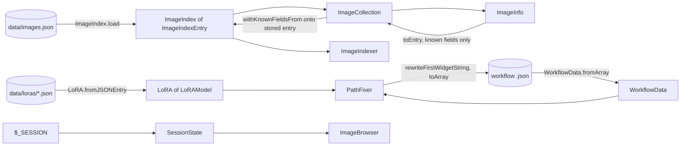

# Plan

## Plan Audit Cycles
- Audits: 1 (Sonnet 5.5 ×1) — Plan Auditor v1.11.0
- Architectural Reviews: 1 (Sonnet 5.5 ×1) — Plan Architect Reviewer v2.3.4

## Prior Project Context

The ledger holds no project history or strategic vision for `comfyui-image-organizer`. One global insight shaped the test design: *Data-driven cross-validation tests catch silent drift between parallel data representations* (`5da200d8-62bd-44fe-ad48-8a2df15e0a07`). The index and LoRA DTOs are therefore tested against the real data files (`data/images.json`, `data/loras/loras.json`) as well as against synthetic arrays.

## Summary

Raising PHPStan from level 8 to level 9 means removing 21 findings, all of which are `mixed` values flowing into typed positions. The developer's diagnosis is right: 17 of the 21 come from untyped JSON shapes (the image index, the sidecar, the LoRA definition files, ComfyUI workflow files); 4 come from `$_SESSION` and request reads that need typed getters, not DTOs. This plan introduces DTOs at exactly the JSON boundaries where the app reads a file into an array: `ImageIndexEntry` and `ImageIndex` for `data/images.json`, a `LoRAModel` variant object plus a `LoRA::fromJSONEntry()` factory for `data/loras/*.json`, and a single `WorkflowData` class for ComfyUI workflows. It adds a small static `SessionState` accessor and typed request getters for the rest, and raises `phpstan.neon` to level 9 once the code is clean. The sidecar boundary belongs to the existing plan `2026-10-07-structured-sidecar-metadata`; this plan only adds an interim typed read there. As a side effect the LoRA normalization resolves the known "LoRA data shape" gap: all 72 entries of the tracked `loras.json` use a nested `models` shape that `LoRA` cannot read today. After the change 68 of the 72 entries expose a model with both a `file` and a `source`; the other four (`cyberSteamPunk`, `steamPunkMagic`, `snowyLandscapes` with an empty `file`, `vampireFangs` with an empty `source`) are empty in the data itself, so `PathFixer` still warns for the first three.

## Architectural Context

- **Boundary today.** `JSONFile::getData()` returns `array<int|string,mixed>`. `ImageCollection` (`$data`) and `ImageIndexer` (`$images`) each hold `data/images.json` as an untyped array and index into it (`$entry['id']`, `$this->images[$id][properties][folder]`). `LoRAsCollection::loadDataFile()` passes raw entries to `LoRA`. `PathFixer::fixPaths()` mutates the decoded workflow by reference. `ImageBrowser` reads `$_SESSION` directly.
- **Existing typed facades.** `ImageProperties` and `LoRA` already wrap `ArrayDataCollection` (typed `getString/getInt/getBool`); these are the project's de-facto DTO idiom, but the raw array reaches them untyped. `ImageInfo` is the domain record, built from a raw entry by `fromSerialized(mixed)` and written back by `serialize()`.
- **Folders.** Domain folders under `src/ComfyUIOrganizer/` (`LoRAs/`, `Workflows/`, `Pages/`, `Ajax/`), classmap autoload, one `context.yaml` block per module.
- **Real data shapes** (measured, see `research-brief.md`): `images.json` has 3,208 entries keyed by id; optional keys `modified` (missing on 889), `label` (missing on 958) and a legacy top-level `forGallery` (590); property bag values are only `string` or `bool`. `loras.json` has 72 nested entries (12 with two models), `nsfw.json` (local) uses the flat shape.
- **The 21 findings, by owner:**

| Source | Findings | Fixed by |
|---|---|---|
| Image index (`ImageCollection` ×3 incl. request read, `ImageIndexer` L67/179/181, `ImageInfo` ×3) | 9 | `ImageIndex` / `ImageIndexEntry` (Steps 3–6) |
| Image request read (`ImageCollection` L181–182) | 2 | typed request getter (Step 10) |
| Bag value (`ImageProperties` L115) | 1 | typed bag read (Step 7) |
| Sidecar reads (`ImageIndexer` L204–221) | 4 | interim typed read (Step 6); replaced later by `ImageMetadata` of the sidecar plan |
| LoRA files (`LoRAsCollection` L73) | 1 | `LoRA::fromJSONEntry()` + `LoRAModel` (Step 8) |
| Workflow files (`PathFixer` L129, 135) | 2 | `WorkflowData` (Step 9) |
| `$_SESSION` (`ImageBrowser` ×3) | 3 | `SessionState` (Step 10) |
| Workflow request read (`WorkflowsPage` L57) | 1 | typed request getter (Step 10) |

## Approach / Architecture

**Rule: a JSON file becomes a typed object once, at the point it is read.** Nothing downstream of that point sees a raw array, so `mixed` never reaches a typed position and no `@var` override or ignore comment is needed.

Two kinds of DTO, chosen by whether the app writes the file back:

| Kind | Used for | Properties |
|---|---|---|
| **Round-trip DTO** | `images.json`, workflow files | `fromArray()` hydrates typed fields; `toArray()` writes them back **and re-emits unknown keys**, so nothing the app does not model is lost. |
| **Read-only DTO** | LoRA definitions | A factory normalizes shapes and ignores unknown keys; no `toArray()`. |

Unknown keys of an index entry live **only on the stored `ImageIndexEntry`**. The domain record `ImageInfo` never carries them: `ImageCollection::save()` merges the changed image's known fields onto the stored entry, so the persistence concern stays inside the persistence classes and `ImageInfo::serialize()` (the browser payload) stays exactly today's key set.

### New classes

The image-index DTOs sit in the root namespace `Mistralys\ComfyUIOrganizer`, beside `ImageInfo` and `ImageCollection`, which they serve and whose `KEY_*` constants they reuse; the LoRA and workflow types sit in their existing domain folders. No new folder and no new `context.yaml` module block are needed.

| Class | Location | Role |
|---|---|---|
| `ImageIndexEntry` | `ImageIndexEntry.php` | One index record. Typed fields: `id`, `imageFile`, `sidecarFile`, `date` (ISO string), `checkpoint`, `upscaled`, `modified`, `label`, `imageSize` (`array{width:int,height:int}`), `properties` (`array<int|string,mixed>`), plus unknown top-level keys. Constructor: `__construct(string $id, string $imageFile, string $sidecarFile, string $date, string $checkpoint, bool $upscaled, bool $modified, string $label, array{width:int,height:int} $imageSize, array<int|string,mixed> $properties, array<string,mixed> $extra = array())` (field order follows the `ImageInfo` constructor; `$extra` holds the unknown keys). Read accessors: `getID()`, `getImageFile()`, `getSidecarFile()`, `getDate()`, `getCheckpoint()`, `isUpscaled()`, `isModified()`, `getLabel()`, `getImageSize()`, `getProperties()`, `getExtra()` (needed by `ImageInfo::fromEntry()`, the indexer's `modified === true` test and the tests). `fromArray(array<int|string,mixed>)` fills defaults (`upscaled=false`, `modified=false`, `label=''`) and hydrates through `ArrayDataCollection` getters. `toArray()` returns the same key order as today's `ImageInfo::serialize()`, then the unknown keys. `syncLocation(string $imageFile, string $sidecarFile, string $folderName): bool` updates the three location values and reports whether anything changed (the indexer's "already modified" path). `withKnownFieldsFrom(ImageIndexEntry $source): ImageIndexEntry` returns a copy that takes every known field from `$source` and keeps this entry's unknown keys (used by `ImageCollection::save()`). Persisted keys reuse the `ImageInfo::KEY_*` constants (single source of truth). |
| `ImageIndex` | `ImageIndex.php` | The id-keyed set of entries. `fromArray()`, `load(JSONFile)`, `save(JSONFile)`, `get(string): ?ImageIndexEntry`, `has()`, `set(ImageIndexEntry)`, `remove()`, `getEntries(): array<string,ImageIndexEntry>`, `count()`. A non-array entry throws `OrganizerException::ERROR_INVALID_INDEX_ENTRY` instead of a `TypeError`. |
| `LoRAModel` | `LoRAs/LoRAModel.php` | One model variant of a LoRA (read-only): `getModelName()`, `getSource()`, `getFile()`, `getTriggerWords(): string[]`, `getNotes()`, `getWeight()`. Hydrated from one array through `ArrayDataCollection` getters; takes over the model-level `KEY_*` constants from `LoRA`. |
| `WorkflowData` | `Workflows/WorkflowData.php` | Typed owner of a decoded ComfyUI workflow, a single class: `fromArray()`, `hasNodes()`, `toArray()`, and `rewriteFirstWidgetString(string $nodeType, Closure $resolver): int`, which applies `$resolver(string): string` to the first widget value of every node of that type whose first widget value is a non-empty string, and returns the number of values that changed. The mutation stays inside the class that owns the document, so no node view and no PHP reference into the nested array is needed. Holds the full decoded document so unknown keys, non-array node entries and node order survive `toArray()` unchanged. |
| `SessionState` | `SessionState.php` | Typed `$_SESSION` access through static methods (matching the static `ImageBrowser::setCardSize()` called from `SetCardSizeMethod`): `getString(string $key, string $default = ''): string`, `getBool(string $key): bool`, `set(string $key, string|bool $value): void`. Wrong-typed or absent values return the default. |

### Changed classes (signatures)

- `ImageInfo`: `fromSerialized(mixed)` is replaced by `fromEntry(ImageIndexEntry): ImageInfo`; new `toEntry(): ImageIndexEntry` yielding **known fields only** (no unknown keys); `serialize()` stays as `toEntry()->toArray()`, which therefore returns exactly today's keys, so the AJAX payload is unchanged (no `forGallery` on legacy entries); unused `KEY_FOR_GALLERY` removed.
- `ImageCollection`: holds an `ImageIndex` instead of `array $data`; `save()` merges each changed image onto its stored entry.

- `ImageIndexer`: holds an `ImageIndex` instead of `array $images`; new `public static resolveCheckpoint(mixed $sidecarValue, string $fallback): string` (pure, interim: removed together with the sidecar code by the structured-sidecar plan).
- `LoRA`: constructor becomes `__construct(string $id, string $label, string $category, LoRAModel[] $models)`; new static factory `fromJSONEntry(string $id, mixed $entry): LoRA` (throws `ERROR_INVALID_LORA_ENTRY` when the entry is not an array; normalizes the nested `models` object — one `LoRAModel` per key — and the flat shape — one model named by the flat `model` value); new per-model accessor `getModels(): LoRAModel[]`; `getFile()` → `getFiles(): string[]`, `getModel()` → `getModelNames(): string[]`; `getSource()`, `getTriggerWords()`, `getNotes()`, `getWeight()` aggregate over models (first non-empty value, trigger words as a de-duplicated union).
- `LoRAsCollection`: `loadDataFile()` registers `LoRA::fromJSONEntry((string)$loraID, $loraData)`.
- `LoRABucket`: `getModels()` / `getByModel()` use `getModelNames()`.
- `PathFixer`: `fixPaths()` works on `WorkflowData` and calls `rewriteFirstWidgetString('LoraLoaderModelOnly', $this->resolvePath(...))`; `buildFileIndex()` iterates `LoRA::getFiles()`.
- `ImageBrowser`: reads and writes UI state through `SessionState`.

## Rationale

- **DTOs where the file is read, not everywhere.** `mixed` is only a problem at the boundary. Typing the boundary once makes every consumer type-safe for free, and a malformed file fails with a named exception where it is read, not three calls later.
- **Round-trip with unknown keys.** `images.json` is the user's curated data (3,208 entries, backed up only during indexing) and workflow files belong to ComfyUI. A closed schema that drops unknown keys would silently destroy data the app does not understand; passthrough costs one `extra` array on the stored entry. Keeping that array off `ImageInfo` keeps the domain record free of persistence residue and the browser payload free of legacy keys.
- **`ImageIndex` as one object.** `ImageCollection` and `ImageIndexer` each re-implement raw-array access to the same file. One typed owner removes the duplication and gives the indexer's location-sync rule a unit-testable home (`syncLocation()`).
- **LoRA models as a list, not one record per model.** LoRA IDs are unique and double as property-bag keys in `images.json`; splitting a LoRA into one record per model would break both. The nested shape is the shipped data format, so the DTO normalizes it instead of keeping a flat getter set that returns empty values for all 72 entries.
- **Thin workflow owner, not a full ComfyUI schema.** The workflow schema is large, versioned and third-party; modelling it would be a maintenance liability. The app needs one intent: rewrite the first widget string of one node type. `WorkflowData` offers exactly that, with the mutation inside the class that owns the document (no node-view type, no reference or write-back seam).
- **`SessionState` is justified by testability.** All `$_SESSION` access is in `ImageBrowser` today (three read sites plus `setCardSize()`, called from `SetCardSizeMethod`); the case for a separate class is that AC-08 (default on absent or wrong-typed value) can only be checked cheaply without the page bootstrap if the accessor is standalone. It is not a DTO; it is the typed boundary for the other `mixed` source. The "further pages will use it" argument is not relied on.

## Considered Alternatives

| Decision | Chosen Shape | Alternatives Considered | Trade-Off Summary |
|---|---|---|---|
| How to type the JSON boundary | Hydrated DTO classes at each file boundary | (a) PHPDoc array shapes on `fromSerialized(array{...})`; (b) keep raw arrays and wrap them in `ArrayDataCollection` at each use | (a) type-checks nothing at runtime and invites the `@var` overrides `constraints.md` forbids; the file can still be malformed. (b) fixes some findings but leaves raw arrays in two classes and no place to put shape rules. DTOs give one runtime-verified shape per file. |
| Unknown keys on round trip | Re-emit them (`extra`) | Closed schema that drops them | Dropping would erase the legacy `forGallery` on 590 entries and any workflow field the app does not model. Passthrough is a few lines. |
| Where the DTOs live | Image-index DTOs in the root namespace beside `ImageInfo` / `ImageCollection`; LoRA and workflow types in their domain folders | (a) A new layer-named `Data/` folder (the original shape of this plan); (b) a central `Data/` for everything; (c) a new `Images/` domain folder | The root holds 10 files and exactly the image-domain classes the DTOs serve, and the `KEY_*` constants already live there; every other folder is a domain or role name, so a layer-named `Data/` contradicted the layout and added a `context.yaml` module block and an exclude edit for two classes. An `Images/` folder would move existing classes, outside this plan's blast radius. (Design review, decision 5: adopted.) |
| Where index unknown keys live | On the stored `ImageIndexEntry` only; `ImageCollection::save()` merges the image's known fields onto it via `withKnownFieldsFrom()` | (a) `ImageInfo` carries them privately so `toEntry()` re-emits them; (b) `ImageInfo` wraps and mutates an `ImageIndexEntry` | (a) mixes a storage concern into the domain record, adds a third parallel field list, and makes `serialize()` serve two audiences, leaking `forGallery` into the AJAX payload for 590 entries against AC-03. (b) rewrites field storage in `ImageInfo`, a file that other plans also edit (the structured-sidecar plan), disproportionate for a static-analysis plan. (Design review, decision 3: adopted.) |
| LoRA DTO layering | `LoRAModel` plus `LoRA` with a `fromJSONEntry()` factory | `LoRAData` + `LoRAModelData` + a delegating `LoRA` (the original shape) | `LoRAData` exposed the same four things as `LoRA` and had no consumer of its own; wrapping a facade in a facade added a class and a constructor change. The factory matches `ImageInfo::fromSerialized()`. (Design review, decision 7: adopted.) |
| Workflow node mutation seam | One `WorkflowData` class with `rewriteFirstWidgetString(string, Closure): int` | (a) `WorkflowData` + `WorkflowNodeData` with a mutating `setWidgetString()` (the original shape); (b) inline `is_array` guards in `PathFixer` | (a) needs a PHP reference into the nested array or a write-back, neither specified, and reference slots make the exact-round-trip guarantee fragile on a ComfyUI-owned file; a node-view type served one consumer. (b) clears the two findings but leaves traversal untestable. (Design review, decision 8: adopted.) |
| Workflow model depth | Single `WorkflowData` owning the decoded document | Fully typed workflow schema | The ComfyUI schema is third-party and changes; the app touches one node type. |
| LoRA multi-model representation | One `LoRA` with a list of `LoRAModel` | One `LoRA` record per (LoRA, model) pair | Per-pair records break ID uniqueness and the ID-as-bag-key contract with `images.json`. |
| Malformed data | Index entries and LoRA entries throw `OrganizerException`, in the browse path **and** in `ImageIndexer::loadIndex()`; workflow nodes and session values are skipped or defaulted | (a) Always throw; always skip; (b) throw when browsing but tolerate and drop a bad entry in the indexer (a `lenient` flag or second factory) | A corrupt index must be loud, and a backup exists. (b) was reconsidered per design review decision 9 and **rejected**: today's `TypeError` already stops the indexer on a corrupt entry, so strictness is not a regression; a repair mode needs a user policy on dropping curated entries (and logging them) that this plan cannot infer, and it adds a flag and a second code path to a plan about static typing. Recorded under Out of Scope as a candidate follow-up. Workflow files are third-party and may hold nodes the app does not care about; session values are untrusted by nature. |
| `ImageSize` DTO | Keep `array{width:int,height:int}` | A small `ImageSize` class | Two fields, no behaviour, one consumer (`ImageInfo`); the array shape is already precise. Revisit if size gains behaviour. |
| Session typing | Static `SessionState` class | Private helper in `ImageBrowser` | All nine `$_SESSION` sites are in `ImageBrowser` today, so the case rests on testability, not on future pages: a standalone accessor lets AC-08 (default on wrong type) be asserted without the page bootstrap. Static methods match the static `ImageBrowser::setCardSize()` called from `SetCardSizeMethod`; tests reset `$_SESSION` in `setUp()`. |

## Pattern Alignment

- Typed facade over `ArrayDataCollection` — follows `src/ComfyUIOrganizer/ImageProperties.php`, `LoRAs/LoRA.php`; the DTOs hydrate through the same getters, no new dependency.
- Static factory from a raw entry — follows `ImageInfo::fromSerialized()` in `ImageInfo.php`; `LoRA::fromJSONEntry()` has the same shape.
- First-class callables / closures as intent parameters — follows the `$this->onPropertiesModified(...)` callback passed to `ImageProperties` in `ImageInfo.php`; `WorkflowData::rewriteFirstWidgetString()` takes `$this->resolvePath(...)`.
- Root-namespace image-domain classes — the index DTOs sit beside `ImageInfo` / `ImageCollection`; no new folder.
- Persisted key names as `KEY_*` constants — follows `ImageInfo.php`; `ImageIndexEntry` reuses the existing constants rather than duplicating them.
- Exceptions with unique integer codes — follows `OrganizerException.php`; three new codes (179403–179405) in the 1794xx block, continuing after 179401 and 179402.
- Domain folders with a `context.yaml` module block — follows `LoRAs/`, `Workflows/`; no new module is added.
- Tests — follows the conventions fixed by the structured-sidecar plan (tests mirror `src/`, namespace `Mistralys\ComfyUIOrganizer\Tests\...`, PHP attributes for data providers, no shared helper classes because there is no `autoload-dev`, fixtures under `tests/fixtures/`, `failOnWarning`). Whichever plan lands first sets the convention; the other follows it.
- **Departures:** (1) `LoRA` gains a multi-model API where it had flat getters — justified by the shipped data format. (2) `ImageIndexEntry` carries one mutating method (`syncLocation()`) while its other transformation (`withKnownFieldsFrom()`) and the other DTOs are read-only or immutable — justified because the entry lives for a single load–edit–save cycle, the indexer replaces the entry in the index on the next line anyway, and the rule needs a testable home; an immutable `withLocation()` was weighed and judged a marginal gain.

## Structural Improvements

| Structure | Observation | Decision | Reason |
|---|---|---|---|
| `ImageCollection::$data` and `ImageIndexer::$images` | Two untyped copies of the same file contract | Promoted to steps 3, 5, 6 | They are the source of 9 findings; one `ImageIndex` removes the duplication. |
| `ImageIndexer::analyzeImage()` modified-image branch (L157–186) | Three-level raw array reads and writes with an `$updated` flag | Promoted to step 6 | Becomes `ImageIndexEntry::syncLocation()`, unit-testable. |
| `ImageInfo::fromSerialized(mixed)` with `KEY_DEFAULTS` | Untyped parameter; default filling lives on the record | Promoted to step 4 | Defaults move into the entry; `fromEntry()` takes a typed object; unknown keys stay on the stored entry, not on the record. |
| `ImageInfo::KEY_FOR_GALLERY` | Declared, referenced nowhere; legacy persisted key | Promoted to step 4 | Dead constant removed; the legacy key survives in the stored entry's unknown-key passthrough. |
| `ImageIndexer` second `parseText($text)` call (L221) | Same text parsed twice | Promoted to step 6 | One of the 4 sidecar findings; the first result is reused. |
| `LoRA` / `LoRAsCollection` flat-shape reading | Returns empty values for all 72 tracked entries (known gap) | Promoted to step 8 | `constraints.md` requires resolving it before changing LoRA reading; `LoRA::fromJSONEntry()` is the natural place. |
| `LoRABucket::getModels()` / `getByModel()` | Built on the single `getModel()`; `getByModel*` has no callers | Promoted to step 8 | Adapted to `getModelNames()`; removing the unused methods is rejected as outside the blast radius. |
| `PathFixer::fixPaths()` by-reference mutation | Traversal, matching and persistence in one method over a raw array | Promoted to step 9 | Traversal and mutation move onto `WorkflowData::rewriteFirstWidgetString()`; matching (`resolvePath()`) and persistence stay in `PathFixer`. |
| `ImageBrowser` raw `$_SESSION` | Type checks absent; reads open-coded | Promoted to step 10 | `SessionState`. |
| `ImageProperties` bag as `ArrayDataCollection` | Open key set (LoRA IDs as keys) | Rejected | A typed class cannot model keys defined by a data file; the facade is already typed. Only `getLoRASummary()` is fixed (step 7). |
| `PathFixer` static dependencies (`OrganizerApp::create()`, `LoRAsCollection::getInstance()`) | Prevents unit-testing the matching logic | Rejected | Dependency injection reaches well beyond the blast radius of this work; covered by `WorkflowData` tests plus a manual test. |
| `ImageIndexer` reversed `str_contains` upscale check | Known defect in `constraints.md` | Rejected | Fixing it changes which images are flagged upscaled; it needs its own plan (same decision as the sidecar plan). |
| `ImageIndexer` sidecar reading in general | Raw sidecar arrays | Rejected here | Owned by `2026-10-07-structured-sidecar-metadata`, whose `ImageMetadata` is the sidecar DTO; only an interim typed read is added (step 6). |

## Detailed Steps

1. **Record baselines.** Run `composer analyze` (level 8; expect zero findings) and `php vendor/bin/phpstan analyse --level=9` (expect the 21 findings listed above) and keep both outputs for comparison. Run `git status`; if any file under `src/` is already modified, treat it as the user's uncommitted work: edit additively, never revert.
2. **Add exception codes.** In `src/ComfyUIOrganizer/OrganizerException.php` add `ERROR_INVALID_INDEX_ENTRY = 179403`, `ERROR_INVALID_LORA_ENTRY = 179404` and `ERROR_CANNOT_HASH_IMAGE_FILE = 179405` (thrown by `ImageIndexer` in Step 6 when `hash_file()` returns `false`). At planning time a grep of `src/` showed only 179401 and 179402 in use; grep again first to confirm all three are unused.
3. **Add the index DTOs** `ImageIndexEntry.php` and `ImageIndex.php` in `src/ComfyUIOrganizer/` as specified above. `ImageIndexEntry::fromArray()` reads typed values with `ArrayDataCollection` getters, defaults `upscaled`/`modified` to `false` and `label` to `''`, and moves every key outside the known set into the unknown-key array. `toArray()` emits known keys in the order of today's `ImageInfo::serialize()` and then the unknown keys. `withKnownFieldsFrom()` takes all known fields from the source entry and keeps this entry's unknown keys. `ImageIndex::fromArray()` keys entries by the entry `id`; a non-array entry throws `ERROR_INVALID_INDEX_ENTRY` naming the key.
4. **Adapt `ImageInfo`.** Replace `fromSerialized(mixed)` and `KEY_DEFAULTS` with `fromEntry(ImageIndexEntry)`; add `toEntry()`, which yields known fields only and never carries unknown keys; implement `serialize()` as `$this->toEntry()->toArray()` so the `MoveImageMethod` and `SetLabelMethod` payloads keep exactly today's keys and values (no `forGallery`). Remove the unused `KEY_FOR_GALLERY` constant.
5. **Adapt `ImageCollection`.** Replace `private array $data` with `private ImageIndex $index`, loaded through `ImageIndex::load($dataFile)`. `deleteImage()` calls `$index->remove($id)`; `save()` takes the stored entry for each changed image from the index, sets `$stored->withKnownFieldsFrom($image->toEntry())` (or the plain `toEntry()` result when the id is not yet stored) and then calls `$index->save($this->dataFile)`, so unknown keys never leave the index layer; `registerItems()` iterates `getEntries()` and calls `ImageInfo::fromEntry()`. `getFromRequest()` reads the parameter with `->getString()` instead of `->get()` (finding L181–182), keeping the `!empty($id)` guard.
6. **Adapt `ImageIndexer`.** Replace `private array $images` with `private ImageIndex $images`; `loadIndex()` keeps the backup copy and loads through `ImageIndex::load()`; `count($this->images)` and the final write use the index. In the modified-image branch replace the nested array access with `$entry->syncLocation($file, $sidecar, $folder)` and keep the console and analysis-result messages and the `modified === true` short-circuit exactly as they are. Build new records with `new ImageIndexEntry(...)`; when the id is already stored (a re-analysed, non-modified image) store `$stored->withKnownFieldsFrom($new)` instead of the bare new entry, so the stored entry's unknown keys (such as `forGallery`) survive re-analysis (today's replacement drops them; this is a deliberate, harmless improvement that keeps AC-02's "nothing is removed" true on every write path). For the sidecar: read `$data[$date]` into an `ArrayDataCollection` only after checking it is an array and take `custom_text` with `getString()`. Take the raw `checkpoint` with `getKey('checkpoint')` (the raw value or `null`) — **not** `getStringN()`, which also returns `null` for `''` — and pass it to `ImageIndexer::resolveCheckpoint(mixed $sidecarValue, string $fallback): string`, where `$fallback` is the parsed text's `modelName` when that is a string and `''` otherwise. `resolveCheckpoint()` returns the sidecar value when it is a string, **including `''`**, and the fallback when the value is absent, `null` or not a string. This reproduces `$properties['checkpoint'] ?? $props[modelName] ?? ''`: an explicitly empty `checkpoint` does not fall back to `modelName`, and the existing `empty($checkpoint)` check still skips that image (`ACTION_SKIP_NO_CHECKPOINT`). The one deviation, a non-string checkpoint in a malformed sidecar, is treated as absent (today it reaches a typed position). Parse `custom_text` once and reuse the result. This sidecar code is deliberately minimal: the structured-sidecar plan deletes it when it replaces `analyzeImage()` with the `Metadata/` module. Hash the image: `hash_file('md5', ...)` returns `string|false`, and level 9 raises `argument.type` when that value reaches the new `string $id` parameters. Where it returns `false`, throw `OrganizerException` with `ERROR_CANNOT_HASH_IMAGE_FILE` (message names the image file path) instead of continuing; the failure is highly unlikely (an unreadable file that was just found by the scan), so throwing is the chosen handling, and no cast, `@var` override or ignore comment is used.
7. **Fix `ImageProperties::getLoRASummary()`.** Iterate the LoRA IDs that exist in the bag and read each weight with `$this->data->getString($id)` so `str_replace()` receives a string; keep the `ksort` order and the output format.
8. **Add the LoRA model type and migrate consumers.** Add `LoRAs/LoRAModel.php` (one variant, hydrated from an array through `ArrayDataCollection` getters; the model-level `KEY_*` constants move here). Rework `LoRA` as described under Changed classes: constructor `(string $id, string $label, string $category, LoRAModel[] $models)`, static `fromJSONEntry(string $id, mixed $entry)` that throws `ERROR_INVALID_LORA_ENTRY` for a non-array entry, detects the nested shape by a `models` array (one `LoRAModel` per key, key = model name) and otherwise builds a single model from the flat keys named from the flat `model` value; add `getModels(): LoRAModel[]` and the aggregate getters (`getFiles()`, `getModelNames()`, `getSource()`, `getTriggerWords()`, `getNotes()`, `getWeight()`, `getLabelLinkedSource()`, `getTriggerWordsFlattened()`). In `LoRAsCollection::loadDataFile()` register `LoRA::fromJSONEntry((string)$loraID, $loraData)`. Update `LoRABucket::getModels()` and `getByModel()` to `getModelNames()`. In `PathFixer::buildFileIndex()` iterate `getFiles()` per LoRA, adding every non-empty file to the known-file map and keeping the "has no file specified" warning for a LoRA with none.
9. **Add `WorkflowData` and migrate `PathFixer::fixPaths()`.** Add `Workflows/WorkflowData.php`. `fixPaths()` builds `WorkflowData::fromArray($this->workflowFile->getData())`, returns early without a message when `hasNodes()` is false (as today), calls `rewriteFirstWidgetString('LoraLoaderModelOnly', $this->resolvePath(...))` (a node is rewritten only when its first widget value is a non-empty string and the resolver returns a different value), treats a returned count of `0` as "no changes", and otherwise writes `toArray()` after the existing backup. Keep the backup step, the "No changes necessary" notice and the empty-object restoration (`flags`, `config`, `properties`) as they are.
10. **Add `SessionState` and typed request reads.** Create `src/ComfyUIOrganizer/SessionState.php` with static methods. Replace the `$_SESSION` reads and writes in `ImageBrowser::setCardSize()`, `resolveActiveCardSize()`, `resolveBooleanToggle()` and `resolveActiveFolder()` with it, keeping the enum validation and defaults and the static signature of `setCardSize()`. In `WorkflowsPage::preRender()` read the workflow ID with `->getString()` instead of `->get()`.
11. **Autoload, tests, level 9.** Run `composer dump-autoload` (classmap). Write the tests in the Test Plan. Run `composer test` and `composer analyze` at level 8 until both are clean, then set `level: 9` in `phpstan.neon` and run `composer analyze` again; expect zero findings with no baseline and no ignore comments.
12. **Update documentation and CTX configuration** as listed under Documentation Updates.

## Dependencies

- Step 2 precedes 3 and 8 (exception codes); Step 3 precedes 4–6; Step 4 precedes 5; Steps 8 and 9 are independent of 3–7; Step 10 is independent; Step 11 follows all code steps.
- `composer dump-autoload` after every step that adds a class (classmap autoload); it also clears the class-discovery cache through `Builder::postAutoload`.
- Overlap with `docs/agents/plans/2026-10-07-structured-sidecar-metadata/plan.md`: both edit `ImageIndexer`, and the sidecar plan also edits `ImageInfo.php` (its Step 9, `getMetadata()`) and `ImageProperties.php` (its Step 8), which this plan changes in Steps 4 and 7. The regions differ and the constructors stay unchanged (its `ImageInfoMetadataTest` builds an `ImageInfo` through the unchanged constructor), so the risk is merge friction only. The `ImageIndexer` edits here are orthogonal to that plan's Step 7 (index-entry access versus sidecar resolution). If the sidecar plan lands first, Step 6 applies to its refactored `analyzeImage()` and the interim sidecar read is simply not needed; if this plan lands first, the sidecar plan's Step 7 replaces the interim read, and every line of code the sidecar plan adds must already pass PHPStan level 9, so its Step 3 wording ("PHPStan level 6 raises no findings") must be changed to level 9 at that point. The sidecar plan's "level 6" statement is stale either way (`phpstan.neon` is at level 8) and should be corrected when that plan is next touched.
- External: the installed PHPUnit 12 and PHPStan 2.x. No runtime dependency is added.

## Required Components

New:
- `src/ComfyUIOrganizer/ImageIndexEntry.php`, `src/ComfyUIOrganizer/ImageIndex.php`
- `src/ComfyUIOrganizer/LoRAs/LoRAModel.php`
- `src/ComfyUIOrganizer/Workflows/WorkflowData.php`
- `src/ComfyUIOrganizer/SessionState.php`
- Tests listed in the Test Plan under `tests/`, plus `tests/fixtures/` where needed

Modified:
- `src/ComfyUIOrganizer/OrganizerException.php` (three new codes), `ImageInfo.php`, `ImageCollection.php`, `ImageIndexer.php`, `ImageProperties.php`
- `src/ComfyUIOrganizer/LoRAs/LoRA.php`, `LoRAsCollection.php`, `LoRABucket.php`
- `src/ComfyUIOrganizer/Workflows/PathFixer.php`
- `src/ComfyUIOrganizer/Pages/ImageBrowser.php`, `Pages/WorkflowsPage.php`
- `phpstan.neon`, `docs/agents/project-manifest/*` (see Documentation Updates)

## Assumptions

- At planning time `git status` showed no modified file under `src/` (only `.idea/workspace.xml` modified; `.context/`, `TODO.md`, `data/loras/nsfw.json` and `docs/agents/plans/` untracked). Step 1 re-checks it; any modified file found then is the user's work and is edited additively. Nothing is reverted or committed.
- An unmodelled top-level key on an index entry is preserved verbatim on the stored entry, including the legacy `forGallery` on 590 entries, on every write path: `ImageCollection::save()` and the indexer's re-analysis of a non-modified image both merge onto the stored entry (`withKnownFieldsFrom()`). The key is never exposed through `ImageInfo` or the AJAX payload. The first save after this change normalizes entries only by adding defaults the reader already assumed (`modified=false`, `label=''`, `upscaled=false`) and re-ordering known keys; nothing is removed.
- For a LoRA with several models, the overview link uses the first model that has a source and the trigger words are the de-duplicated union across models. The per-model values stay reachable through `LoRA::getModels()` (new in this plan). This is a presentation choice made here because the shipped data has 12 multi-model LoRAs, and SDXL and FLUX variants can legitimately differ in trigger words, so the union may fit neither; it is easy to change in `LoRA` alone.
- Property bag values are `string` or `bool` in practice (measured); the DTO keeps the bag typed as `array<int|string,mixed>` and every read goes through typed getters.
- `ImageIndexer` and `PathFixer` need an application bootstrap and the ComfyUI folder, so they have no automated tests; they are covered through the DTO tests and the manual tests below.
- PHPUnit 12 and PHPStan 2 are installed and configured (`phpunit.xml` has `failOnWarning="true"`); this plan adds tests but no tooling.

## Constraints

- Persist only through `ImageCollection::save()`; keep the `modified` flag semantics and the backup in `ImageIndexer::loadIndex()` (`constraints.md`, "Index integrity").
- `ImageInfo::serialize()` must keep its exact key set (AJAX payload contract with `js/ImageBrowser.js`).
- No `@phpstan-ignore`, no baseline, no inline `@var` overrides, no casts added only to silence a finding (`constraints.md`, "Testing and static analysis").
- `PathFixer` keeps rewriting only `LoraLoaderModelOnly` nodes, first widget value, with the backup and the empty-object restoration (`constraints.md`, "Workflows and LoRA files").
- LoRA IDs stay unique across all files under `data/loras/`.
- `curation-log.md` is not edited by hand.

## Out of Scope

- Sidecar parsing, the structured sidecar format and the `Metadata/` module (plan `2026-10-07-structured-sidecar-metadata`).
- The reversed `str_contains` upscale check in `ImageIndexer`.
- A typed model for the `images.json` property bag or an `ImageSize` class.
- Dependency injection into `PathFixer` or `ImageProperties` to make them unit-testable.
- A lenient indexer load path that reports and drops a non-array index entry instead of throwing (design review, decision 9): a candidate follow-up if the user wants a repair policy for corrupt `images.json` entries.
- A DTO for the "Send to website" JSON payload (`Ajax/Methods/SendToWebsiteMethod.php`) and for `data/file_index.json`; PHPStan level 9 raises no finding for either.
- UI redesign of the LoRA overview beyond showing the data the DTO now provides.
- Fixing the ComfyUI empty-array-versus-object quirk beyond the existing string replacement.

## Human Actions

| # | Action | When | Why an agent cannot do it |
|---|--------|------|---------------------------|
| 1 | Copy `data/images.json` (git-ignored) somewhere safe before first using the updated app. The first UI action that saves normalizes entries (adds defaults, re-orders known keys). | After the run | It protects the user's live data; the run itself only reads `images.json` in tests and never writes it. |
| 2 | Spot-check the updated app in the browser: the LoRA overview shows source links and trigger words, and the image browser still toggles favorites and card size (verifies AC-08's `ImageBrowser` part). | After the run | Needs the browser and the user's judgement of the result. |
| 3 | Regenerate `.context/` with the CTX Generator after the new source files are added. | After the run | The CTX Generator is an external tool outside the agents' documented toolset. |
| 4 | Run `composer index` on a throw-away copy of the image folder and `data/` with the pre-change code (from git) and with the changed code; compare the indexed property bags, entry counts, the `checkpoint` values and that re-analysed non-modified entries keep their unknown keys such as `forGallery` (verifies AC-10). | After the run | Needs the user's live ComfyUI image folders and the old code checked out beside the new. |
| 5 | Run "Fix paths" on a copy of a workflow containing `LoraLoaderModelOnly` nodes with the pre-change and the changed code and diff the results, including the `.bak` file (verifies the `PathFixer` part of AC-07). | After the run | Needs a real ComfyUI workflow file and the running web UI. |
| 6 | In the browser, open an image URL with a valid, an invalid and an absent `imageID`, and the Workflows page with a valid and an unknown workflow ID (verifies AC-09). | After the run | Needs the running web UI and the user's real `images.json` and workflow folders. |

## Acceptance Criteria

- AC-01: `phpstan.neon` is set to `level: 9`, and `composer analyze` reports zero findings across `src` and `tests`, with no baseline file and no `@phpstan-ignore` comment added.
- AC-02: Loading the real `data/images.json` through `ImageIndex` and writing it back through `toArray()` preserves every original key and value of every entry (including unknown keys such as the legacy `forGallery`), adds only the defaults `modified`, `label` and `upscaled`, and a second load-and-write cycle is identical to the first.
- AC-03: `ImageInfo::serialize()` returns exactly the same keys and values as before this change for any entry, including legacy entries that carry `forGallery` (the key is not in the payload); the `MoveImageMethod` and `SetLabelMethod` payloads are unchanged.
- AC-04: A non-array entry in `images.json` throws `OrganizerException` with `ERROR_INVALID_INDEX_ENTRY`; it never raises a PHP `TypeError`.
- AC-05: `ImageIndexEntry::syncLocation()` updates the image file, sidecar file and folder-name property only when they differ and returns `true` exactly when something changed; other values, including `modified`, `label` and the properties other than the folder name, are untouched.
- AC-06: `LoRA::fromJSONEntry()` reads both the nested `models` shape and the flat shape; every entry of the tracked `data/loras/loras.json` yields at least one model, and the models, files and sources that `LoRA` exposes equal the values in the raw JSON (so entries that read as empty today now expose their data: at planning time 68 of the 72 entries have a model with both a `file` and a `source`); `LoRA::getModels()` exposes the per-model values; `LoRA::getTriggerWords()` returns the de-duplicated union; a LoRA entry that is not an object throws `ERROR_INVALID_LORA_ENTRY`; `PathFixer` no longer reports "no file specified" for entries whose models carry a file, and still reports it for an entry whose `file` is genuinely empty (at planning time `cyberSteamPunk`, `steamPunkMagic`, `snowyLandscapes`).
- AC-07: `WorkflowData::fromArray($x)->toArray()` equals `$x` exactly for a workflow with unknown keys, non-array node entries and empty arrays; `WorkflowData::rewriteFirstWidgetString()` changes only the first widget value of nodes of the given type whose first widget value is a non-empty string, returns the number of changed values, and leaves all other content intact; `PathFixer` rewrites only `LoraLoaderModelOnly` nodes through it (post-run verification: Human Action 5).
- AC-08: `SessionState` returns the supplied default for an absent or wrong-typed session value, and `ImageBrowser` behaviour (card size, active folder, boolean toggles) is unchanged (post-run verification: Human Action 2).
- AC-09: Request parameters `imageID` and the workflow ID are read with `->getString()`. Post-run verification (Human Action 6): an invalid or absent `imageID` yields no image, as before; a valid workflow ID runs path fixing as before; an unknown workflow ID raises `RecordNotExistsException` from `getByID()` as before (the call is reached only when the fix-paths flag is set), and an absent one now passes `''`, which raises the same exception.
- AC-10: The index-entry accesses and the interim sidecar read in `ImageIndexer` keep today's semantics. Automated: `ImageIndexer::resolveCheckpoint()` returns an explicitly empty sidecar `checkpoint` unchanged and falls back to `modelName` only for an absent, `null` or non-string value. Post-run verification (Human Action 4): the "already indexed and modified" path updates only paths and folder name, and a `composer index` comparison against the pre-change code shows the same checkpoints and property bags. Where `hash_file()` returns `false`, `ImageIndexer` throws `OrganizerException` with `ERROR_CANNOT_HASH_IMAGE_FILE`; no cast or ignore comment is used, and `string $id` receives only a verified string (guaranteed by level 9 under AC-01 and checked in review, not by an automated test).
- AC-11: The manifest, README, changelog, `AGENTS.md` and the `phpstan.neon` level are updated as listed under Documentation Updates, and the "LoRA data shape" known gap is removed from `constraints.md`.
- AC-12: `ImageIndexEntry::withKnownFieldsFrom()` takes every known field from the source entry and keeps the receiver's unknown keys, so saving a changed image never drops an unknown key (such as `forGallery`) from its stored index entry, and `ImageInfo::toEntry()` never carries unknown keys.

## Testing Strategy

PHPUnit unit tests for all new classes, using synthetic arrays for edge cases and the real data files for shape coverage (index and LoRAs), in the style fixed by the structured-sidecar plan: one test class per production class under `tests/`, mirroring `src/`, namespace `Mistralys\ComfyUIOrganizer\Tests\...`, PHP attributes (`#[DataProvider]`, `#[Group]`), never docblock annotations (PHPUnit 12), no shared helper classes or traits (no `autoload-dev`), typed data providers so PHPStan level 9 passes on `tests/`. `failOnWarning` is on, so a PHP warning from an absent key fails a test. Real-data tests read `data/images.json` and `data/loras/loras.json` through `__DIR__`-relative paths, read-only, and are marked skipped when the file is absent (`images.json` is git-ignored). `ImageIndexer`, `PathFixer`, `ImageBrowser` and `ImageProperties::getLoRASummary()` need the application bootstrap or the LoRA collection singleton and are covered through their DTO and `SessionState` tests, the pure `ImageIndexer::resolveCheckpoint()` rule (called statically, no bootstrap), the type-level guarantee of level 9, and the post-run verifications in Human Actions 2 and 4–6, which have no automated owner in the run. The save-merge rule of `ImageCollection::save()` is covered at the entry level (`withKnownFieldsFrom()`), not through the collection.

## Test Plan

- `tests/ImageIndexEntryTest.php::testFromArrayFillsDefaults` — missing `modified`, `label`, `upscaled` default to `false`, `''`, `false` without PHP warnings — AC-02
- `ImageIndexEntryTest::testToArrayKeepsKeyOrderAndUnknownKeys` — emits id, imageFile, sidecarFile, date, checkpoint, upscaled, imageSize, modified, label, properties, then unknown keys such as `forGallery` — AC-02, AC-03
- `ImageIndexEntryTest::testWithKnownFieldsFromKeepsUnknownKeys` — known fields (including label, modified, properties) come from the source entry, `forGallery` and any other unknown key stay from the receiver, and the receiver is not mutated — AC-12
- `ImageIndexEntryTest::testSyncLocation` (data provider) — unchanged values return `false`; each of image file, sidecar file and folder name changed returns `true` and updates only that value; an empty stored folder name is filled — AC-05
- `tests/ImageIndexTest.php::testNonArrayEntryThrows` — a string entry throws `OrganizerException` with code `ERROR_INVALID_INDEX_ENTRY` — AC-04
- `ImageIndexTest::testSetGetRemoveHas` — entries are keyed by id; `set` replaces; `remove` deletes — AC-02
- `ImageIndexTest::testRealIndexRoundTrip` — the real `data/images.json`: every original key/value survives, only the three defaults are added, a second round trip is identical (skipped when the file is missing) — AC-02
- `ImageIndexTest::testSaveMergePreservesUnknownKeys` — simulating `ImageCollection::save()` (stored entry with `forGallery`, `withKnownFieldsFrom()` of a changed image's `toEntry()`, `set()`, `toArray()`) keeps `forGallery` and applies the changed fields — AC-02, AC-12
- `tests/ImageInfoTest.php::testSerializeKeepsPayloadShape` — `fromEntry()` then `serialize()` returns exactly the legacy key set, values and nested `imageSize`/`properties`, and omits `forGallery` for an entry that has it — AC-03
- `ImageInfoTest::testToEntryHasNoUnknownKeys` — an `ImageInfo` built from an entry carrying an unknown key yields a `toEntry()->toArray()` without it — AC-03, AC-12
- `tests/LoRAs/LoRATest.php::testNestedShape` — `LoRA::fromJSONEntry()` on a two-model entry yields two `LoRAModel` through `getModels()` with their own `file`, `source`, `triggerWords` — AC-06
- `LoRATest::testFlatShape` — a flat entry yields one model named from `model` — AC-06
- `LoRATest::testMissingOptionalKeys` — an entry with only `label` yields no model errors and empty getters — AC-06
- `LoRATest::testTrackedLoraFileMatchesRawJson` — for every entry of `data/loras/loras.json`: `getModels()` has one `LoRAModel` per raw `models` key, and each model's `file`, `source` and `triggerWords` equal the raw JSON values; at least one entry exposes a non-empty `file` and `source` (a guard against the "reads as empty" regression). No hard-coded exception list, since the user edits the file (skipped when absent) — AC-06
- `LoRATest::testTriggerWordsAreDeduplicatedUnion` — two models sharing a trigger word return it once, in first-seen order — AC-06
- `LoRATest::testGetFilesSkipsEmpty` — models without a file are skipped — AC-06
- `LoRATest::testNonObjectEntryThrows` (data provider: string, int, `null`) — `LoRA::fromJSONEntry()` throws `OrganizerException` with code `ERROR_INVALID_LORA_ENTRY` — AC-06
- `tests/Workflows/WorkflowDataTest.php::testRoundTripIsExact` — unknown keys, a non-array node entry, empty `flags`/`config`/`properties` arrays and node order survive `toArray()` — AC-07
- `WorkflowDataTest::testRewriteFirstWidgetString` (data provider) — missing `widgets_values`, empty list, non-string first value and empty-string first value are skipped and counted as `0`; a string first value is passed to the resolver and replaced; the return value is the number of changed values — AC-07
- `WorkflowDataTest::testRewriteTouchesOnlyMatchingNodeTypeAndFirstWidget` — other node types, other widget values and node keys are unchanged; a resolver returning the same value counts as unchanged; nodes without a string `type` are skipped — AC-07
- `tests/ImageIndexerTest.php::testResolveCheckpoint` (data provider) — a non-empty string is returned; an explicitly empty string is returned as `''` and does not fall back; an absent key, `null`, an int and an array return the fallback; an empty fallback yields `''` — AC-10
- `tests/SessionStateTest.php::testDefaultsForMissingAndWrongType` (data provider) — absent key, int, array, `null` return the default; string and bool round-trip; `$_SESSION` is reset in `setUp()` — AC-08
- `composer analyze` at level 9 (manual, Step 11) — zero findings, no baseline, no ignores — AC-01
- No automated test for the `hash_file()` failure branch (`ERROR_CANNOT_HASH_IMAGE_FILE`): it sits in `ImageIndexer::analyzeImage()`, which needs the application bootstrap and cannot be forced without an unreadable file. It is verified through the level 9 type-level guarantee (a `string|false` reaching `string $id` fails `composer analyze`) and the Step 12 review check — AC-10, AC-01
- Post-run verification, user-owned (Human Action 4): `composer index` comparison against the pre-change code — AC-10
- Post-run verification, user-owned (Human Action 5): "Fix paths" diff on a workflow copy — AC-07
- Post-run verification, user-owned (Human Actions 2 and 6): browser spot-check and the request-parameter cases — AC-08, AC-09
- Review check (Step 12): every document in Documentation Updates is changed and the "LoRA data shape" gap is gone from `constraints.md` — AC-11

## Documentation Updates

- `docs/agents/project-manifest/api-surface.md` — `ImageIndexEntry` and `ImageIndex` in the root-namespace section, `LoRAModel`, `WorkflowData`, `SessionState`; `ImageInfo::fromEntry()/toEntry()` replacing `fromSerialized()`, removal of `KEY_FOR_GALLERY`; `LoRA` constructor, `fromJSONEntry()`, `getModels()` and getter changes; `ImageIndexer`: new public static `resolveCheckpoint(mixed $sidecarValue, string $fallback): string` in the `ImageIndexer` section, and the `ImageIndex` property replacing the raw array; `OrganizerException` new codes `ERROR_INVALID_INDEX_ENTRY` (179403), `ERROR_INVALID_LORA_ENTRY` (179404) and `ERROR_CANNOT_HASH_IMAGE_FILE` (179405).
- `docs/agents/project-manifest/data-flows.md` — indexing and browsing flows now load `images.json` through `ImageIndex`, with unknown keys kept on the stored entry and merged on save; the LoRA loading path (normalizes both shapes); the workflow path-fixing flow through `WorkflowData`.
- `docs/agents/project-manifest/constraints.md` — add the DTO boundary rule (read every JSON file into a DTO at the point of reading; round-trip DTOs must re-emit unknown keys); update "Testing and static analysis" to level 9 and the first tests; remove the "LoRA data shape" known gap and note that both shapes are supported; rewrite the "No tests written yet" known-gap bullet (false once this plan adds tests) to name what stays untested (`ImageIndexer`, `PathFixer`, `ImageBrowser` need the bootstrap); keep the other known gaps; describe the new tests conventions if the sidecar plan has not already.
- `docs/agents/project-manifest/tech-stack.md` — PHPStan level 9; replace the sentence stating that `tests/` holds only a `.gitkeep` if no earlier plan has done so.
- `docs/agents/project-manifest/README.md` — replace the stale "where to start" pointer to "`constraints.md` (LoRA data shape)" (L25; the gap is removed), and add a pointer for JSON-shape work (the DTO boundary rule in `constraints.md`, `ImageIndex` / `WorkflowData` in `api-surface.md`).
- `README.md` — in the LoRA path-fixing section (L116–L135) document the supported LoRA definition shapes (nested `models` and flat) unconditionally; that section already requires official file names in the LoRA JSON files.
- `changelog.md` — entry: PHPStan level 9, typed JSON data objects, LoRA overview and path fixing now read the nested LoRA format (source, file, trigger words of multi-model LoRAs).
- `AGENTS.md` — Project Stats (PHPStan level 9) and the "Untested code path" row once tests exist.
- `phpstan.neon` — `level: 9`.
- `context.yaml` — no change: the index DTOs are root-namespace files covered by the existing Core block; no new module is added.
- `.context/` — regenerated by the user (Human Action 3), since new source files change `project-folder-structure.md`.

## Risks & Mitigations

| Risk | Mitigation |
|---|---|
| **Index data loss or drift on first save.** `images.json` holds 3,208 curated entries. | Round-trip DTO re-emits unknown keys from the stored entry; `save()` merges known fields onto it; AC-02 and AC-12 tests (including the real file); the indexer's backup is unchanged; Human Action 1 asks for a copy before first use. |
| **AJAX payload changes** and breaks `js/ImageBrowser.js`. | `serialize()` is `toEntry()->toArray()` with known keys only and the old key order, so no unknown key leaks; AC-03 asserts the exact key set, including for a `forGallery` entry. |
| **LoRA behaviour change.** The overview and `PathFixer` suddenly see data they never saw (72 entries). | This is the intended fix of a documented defect; the changelog calls it out; multi-model aggregation rules are stated in Assumptions. |
| **Workflow rewrite corrupts a ComfyUI file.** | `WorkflowData` keeps the whole document and owns the mutation (no references into the nested array); AC-07 round-trip test; backup and empty-object restoration unchanged; manual diff test. |
| **Merge friction with the structured-sidecar plan** in `ImageIndexer`, `ImageInfo.php` and `ImageProperties.php`. | Edits are orthogonal (different regions, `ImageInfo` constructor unchanged) and the interim sidecar read is small; Dependencies name all three files and describe either landing order, including the level-9 obligation on the sidecar plan's new code if this plan lands first. |
| **A corrupt index entry blocks the indexer** that would otherwise rebuild it. | Same outcome as today's `TypeError`, but now with a named exception and key; the backup exists; a lenient repair mode is a recorded follow-up (Out of Scope), not part of this plan. |
| **User edits appearing in the same files** before or during the run. | `git status` is inspected in Step 1 (none under `src/` at planning time); any modified file is edited additively and `git diff` is checked after each file. |
| **`null` versus empty semantics lost in the interim sidecar read** (`??` versus a typed getter: `getStringN()` returns `null` for `''` and would change which images are indexed). | `getKey()` plus `resolveCheckpoint()` (Step 6) keep `??` semantics; `ImageIndexerTest::testResolveCheckpoint` asserts the empty-string case (AC-10); Human Action 4 compares a real index run. |
| **ACs verified only by the user after the run** (AC-07 `PathFixer`, AC-08 `ImageBrowser`, AC-09 and the AC-10 comparison are not automated). | They are Human Actions 2 and 4–6 with `After the run` timing and worded as post-run verifications; the logic they exercise is covered by the automated tests listed under the same ACs. |
| **Strict level 9 in `tests/`** makes data providers and fixtures noisy. | Typed provider return shapes; fixtures decoded through the DTOs, not raw arrays. |

## Recommended Workflow

- **Workflow:** ledger
- **Rationale:** The change spans several modules, alters a persisted-data read/write path and a user-visible LoRA feature, introduces the repository's first tests, and overlaps another plan in `ImageIndexer`, so it benefits from separate QA, security and review stages.
