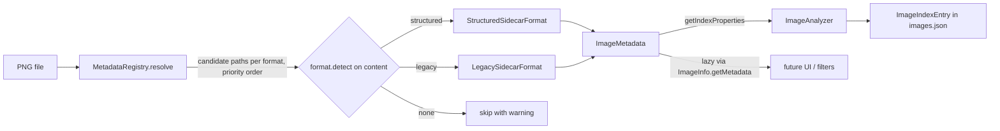

# Plan

## Plan Audit Cycles
- Audits: 2 (Sonnet 5.5 ×2) — Plan Auditor v1.11.0
- Architectural Reviews: 1 (Sonnet 5.5 ×1) — Plan Architect Reviewer v2.3.4

## Prior Project Context

The ledger holds one completed project for `comfyui-image-organizer`: `2026-10-07-phpstan-level-9-data-shapes` (release 1.1.0). Its `synthesis.md` is the source of the revision that this plan went through; every leftover topic of that synthesis is either promoted into the steps below or recorded in *Deferred Items*. Strategic vision: short term, make workflow metadata handling more reliable and stable on the new data-collection system (this plan); mid term, performance and GUI for a growing collection (the reason the full metadata stays a lazy accessor instead of growing `images.json`).

What the completed project changed under this plan:

- PHPStan runs at level 9 with no baseline file and no ignore comments, over `src/` and `tests/`. All new code must meet it.
- JSON files are read into typed data objects at the boundary (`ImageIndex`, `ImageIndexEntry`, `LoRA`, `WorkflowData`), and `ImageIndexer` already read the sidecar through an interim typed read (`resolveCheckpoint()`, `ACTION_SKIP_NO_DATE`) that this plan replaces.
- The repository has 56 PHPUnit tests and test conventions; the earlier assumption that `tests/` is empty no longer holds.
- `ImageIndexer` merges a re-analyzed entry onto the stored one with `ImageIndexEntry::withKnownFieldsFrom()` and syncs moved images with `ImageIndexEntry::syncLocation()`; both guarantees must survive the refactor.

Insights that shaped the plan:

- *Typed objects over user-editable JSON must carry unknown keys and be validated by round-tripping real data* (`a0d77d59-4cec-4837-b568-c0fe06ce66cf`): the same real-data discipline applies to the sidecar parser. The metadata objects are read-only and never written back, so there is nothing to re-emit, but the legacy parser is validated against every real legacy sidecar (Step 1 and Step 12), not against synthetic fixtures alone.
- *Data-driven cross-validation tests* (`5da200d8-62bd-44fe-ad48-8a2df15e0a07`): the model for the read-only `verify-metadata` census command (Step 10) and for the one-off comparison of the stored index with a fresh parse (Step 12).
- *PHPUnit 12: `@group` annotations are silently ignored* (`65d6e5d4-6ccf-413d-adac-3c5ce8b7a8ed`): tests use attributes (`#[DataProvider]`, `#[Group]`), never docblock annotations.
- *Characterisation tests as a deliberate boundary marker for deferred fixes* (`76d1cee5-c759-44ae-8e66-ece748505b0d`): the reversed `str_contains` upscale check stays unfixed and is pinned by a characterisation test (Test Plan).
- *Path-fixer notices: untrusted values must enter messages as arguments* (`14c17680-fe1d-4b4c-8477-31a55c7b8d71`): the indexer's result messages are only counted and echoed to the console today, but the new warnings still carry the file name only, never sidecar content or exception text.

## Summary

The organizer indexes images through a JSON sidecar written by the old "Save Image Extended" node (date-keyed, with a `custom_text` string). The new metadata nodes write a structured sidecar (`image` / `prompt` / `model` / `sampler` / `upscale` / `loras` / `flow`) in a differently named file, and the indexer neither finds nor understands it. This plan adds a metadata module that finds a PNG's sidecar, detects its format from its content, and parses it into one immutable, nullable-typed `ImageMetadata` object. The per-image decision logic of `ImageIndexer` is extracted into a testable `ImageAnalyzer` that runs on that module, structured images are indexed with the same property-bag keys the UI already reads, and every additional field (flow type and version, preview flag, refiner and preview steps, upscale details, LoRA trigger words, the raw sidecar) is reachable through a lazy accessor on `ImageInfo` without being consumed by the UI yet. Legacy indexing must stay byte-identical, and the indexer's data-preservation decisions (the `modified` short-circuit, the location sync, the unknown-key merge), which have no tests today, get tests as part of the refactor.

## Architectural Context

- **Indexing** — `src/ComfyUIOrganizer/ImageIndexer.php`: `analyzeImages()` pairs each PNG with `str_replace('.png', '.json', …)`; the private `analyzeImage()` hard-wires the legacy shape (date key via `key($data)`, `custom_text` via the private `parseText()`, checkpoint via the public static `resolveCheckpoint()`, `checkpoint`/`modelName` skip rule), short-circuits `modified` entries with `ImageIndexEntry::syncLocation()`, merges a re-analyzed entry onto the stored one with `withKnownFieldsFrom()`, and reports through an `OperationResult_Collection` (`ACTION_UPDATE_PATHS` 180901, `ACTION_SKIP_NO_CHECKPOINT` 180902, `ACTION_IMAGE_INDEXED` 180903, `ACTION_SKIP_NO_DATE` 180904). It reads the sidecar through `JSONFile::getData()` and `ArrayDataCollection` and is not testable without the application bootstrap: its constructor takes an `OrganizerApp`, whose storage file points at the real `data/images.json`.
- **Index model** — `ImageIndex` (entries keyed by image ID) and `ImageIndexEntry` (typed record that keeps unknown keys); `ImageInfo::fromEntry()` / `toEntry()` convert between the record and the domain object.
- **Record and bag** — `ImageInfo` (index record, MD5 id, sidecar path) and `ImageProperties` (typed getters over a flat string-keyed bag that also carries LoRA weights under the LoRA ID). Nothing in the UI reads a bag key it does not know, so adding keys is invisible to pages. The indexer's `ImageBrowser` caller only counts the results (`countSuccesses()`, `countNotices()`); no page renders the result messages.
- **Discovery pattern** — `OrganizerApp::registerAjaxMethods()` finds classes by folder scan with an interface filter (`ClassHelper::findClassesInRepository`), which needs the class-cache folder that only `prepend.php` sets.
- **Tooling** — Composer classmap autoload, `Builder` static CLI entry points, PHPUnit 12 (56 tests, `failOnWarning`) and PHPStan level 9 over `src/` and `tests/` with no baseline.
- **Data on disk** (measured, see `research-brief.md`): 3,543 legacy sidecars, 98 structured sidecars (95 named `*-meta.json`, 3 early `*-meta_NNNNN.json`), and 5 workflow-export JSON files that occupy the legacy sidecar file name. `flow.typeName` exists in only 33 of 95 `-meta.json` files and the only value seen is `FLUX1`. `data/images.json` holds 3,208 entries, 590 of them with unknown extra keys. The 3,543 date-keyed files include 17 `jobs.json` files (2–31 date keys each, never paired with a PNG) and six PNG sidecars in `FluxTests/` with two date keys (`146-…u01.json`, `151-…`, `152-…`, `153-…`, `155-…`, `158-…`); the indexer reads only the first key (`key($data)`), so multi-key sidecars are indexed today and must stay indexed.

## Approach / Architecture

New module `src/ComfyUIOrganizer/Metadata/` (namespace `Mistralys\ComfyUIOrganizer\Metadata`):

| Class | Role |
|---|---|
| `SidecarFormatInterface` | One sidecar schema family: `getID()`, `getPriority()`, `getSidecarCandidates(FileInfo $image): string[]`, `detect(ArrayDataCollection $data): bool`, `parse(ArrayDataCollection $data): ImageMetadata`. The registry wraps the decoded JSON in an `ArrayDataCollection` at the point of reading, so no format receives a raw decoded array (the typed-boundary rule in `constraints.md`). |
| `BaseSidecarFormat` (abstract, in `Metadata/`, not in `Formats/`) | Shared lenient readers (`?string`, `?int`, `?float`, `?bool` from a key of an `ArrayDataCollection`) built on `getKey()` with `is_*` narrowing, the same technique as `ImageIndexer::resolveCheckpoint()`, so level 9 passes without casts, `@var` overrides or ignores; float normalization (round to 4 decimals). |
| `Formats/StructuredSidecarFormat` | ID `structured`, priority 100. Candidates: `<stem>-meta.json`, `<stem>-meta_<NNNNN>.json`, where `<stem>` is the PNG base name without its trailing `_NNNNN_`. Detects `image` + `prompt` + `sampler` objects. Reads `flow` leniently: `typeName`, `version`, `isPreview`, `isNegativePromptEnabled` are each optional. |
| `Formats/LegacySidecarFormat` | ID `legacy`, priority 200. Candidate: `<png path without the .png extension>.json`. Detects on the **first** top-level key, exactly as the indexer's `key($data)` reads it today: a string key whose value is an object, in a file that is neither structured-shaped (`image` + `prompt` + `sampler`) nor workflow-export-shaped (`nodes` + `links`); further top-level keys (multi-key sidecars exist) are ignored. Parsing logic moved verbatim from `ImageIndexer::parseText()`; also takes over `ImageIndexer::resolveCheckpoint()` as a public static method with the same contract (a string `checkpoint` wins, even when empty; any other value falls back to `modelName`). Throws `MetadataException` when the resolved model name is empty (preserves today's skip rule). |
| `MetadataRegistry` | Discovers formats by folder scan of `Metadata/Formats/` with an interface filter, sorted by priority. `getInstance()` serves the application (scan once per process); `create()` builds a fresh one for tests. `resolve(FileInfo $image): SidecarResolution` walks formats in priority order in a single pass, tries each format's candidates, and accepts a candidate only when the format's `detect()` recognizes its content; a candidate that is not valid JSON or has a non-object root counts as unrecognized, never as an exception (the registry catches `FileHelper_Exception` and `\TypeError`, because `JSONFile::getData()` is declared `: array` and a scalar root surfaces as a `TypeError`). `createWithFormats(SidecarFormatInterface[] $formats)` builds a registry over an explicit format list (consumers: `MetadataVerifierTest` with a throwing stub format; the folder scan stays the default for the application). The same pass collects every existing candidate that no format recognized, so the indexer gets the sidecar and the reason for a miss from one result and not from two walks over the candidate list that could drift apart. `parseFile(JSONFile): ImageMetadata` for the lazy path. |
| `SidecarResolution` | Result of `MetadataRegistry::resolve()`: `getSidecar(): ?ResolvedSidecar`, `isResolved(): bool`, `getUnrecognizedCandidates(): JSONFile[]` (existing candidate files no format recognized, filled whether or not another candidate was resolved). The growth trajectory is further outcomes (for example an ambiguous match between two formats) that become new accessors here instead of new registry methods. |
| `ResolvedSidecar` | Value object: sidecar `JSONFile`, the matched format, the decoded data as an `ArrayDataCollection`. |
| `ImageMetadata` | Immutable result. All scalar getters are nullable (`?string`, `?int`, `?float`, `?bool`, `?Microtime`); never a magic default. Constructed through a constructor whose parameters are all optional with a `null` default (the format ID is the only required one), and both formats call it with **named arguments**, so a field a format does not supply is `null` by construction and two formats cannot diverge on parameter order; a builder class is the next step only if the field count keeps growing. Contains `getFormatID()`, `getDate()`, `getModelName()`, `getVaeName()`, `getClipNames(): ?string` (the raw string; legacy `clipNames` is one string), `getSeed()`, `getWidth()`, `getHeight()`, `getCFG()`, `getPositivePrompt()`, `getNegativePrompt()`, `getTestName()`, `getTestNumber()`, `getBatchNumber()`, `getFolderName()`, `getFilePrefix()`, `isEmbedFlow()`, `getLoRATriggers(): ?string` (the raw string, kept raw), `getFlow(): FlowInfo`, `getSampler(): SamplerInfo`, `getUpscale(): UpscaleInfo`, `getLoRAs(): ?LoRAUsage[]` (`null` when the format cannot say, `[]` when it says there are none), `getIndexProperties(): array<string,string>`, `getRawData(): array`. Sub-objects are always present; their fields are nullable. |
| `FlowInfo` | `getTypeName(): ?string`, `getVersion(): ?int`, `isPreview(): ?bool`, `isNegativePromptEnabled(): ?bool`. The legacy format fills `getVersion()` from `workflowVersion`; the structured format writes `flow.version` to that same `workflowVersion` bag key, so one persisted key carries the one version series (legacy 1, 28–30; structured 31, 32). |
| `SamplerInfo` | `getName()`, `getScheduler()`, `getSteps()`, `getPreviewSteps()`, `getRefinerSteps()`. |
| `UpscaleInfo` | `getFactor()`, `getSteps()`, `getCalculatedFactor()`, `isUpscaled()`, `getModelName()` (legacy `upscale_model`). |
| `LoRAUsage` | `getID()`, `getStrength(): ?float`, `getTriggerWords(): ?string`. Structured only. The legacy format makes `getLoRAs()` return `null` ("not available"), because its LoRA weights cannot be told apart from other `custom_text` keys without loading the LoRA collection; a structured sidecar with a `loras` object returns a list (empty when the object has no entries) and one without a `loras` section returns `null`. |
| `MetadataException` | Extends `OrganizerException`; codes in the unused 183xxx range: `ERROR_NO_MODEL_NAME`, `ERROR_INVALID_STRUCTURE`. |
| `MetadataVerifier` | Read-only census used by `composer verify-metadata` (Step 10): `census(FileInfo[] $images): array{formats: array<string,int>, noSidecar: string[], unrecognized: string[], noModelName: string[], failures: string[]}` resolves and parses every given PNG through a `MetadataRegistry` passed to the constructor and counts the outcomes; `noModelName` collects the images whose parse raised `MetadataException::ERROR_NO_MODEL_NAME` (the preserved legacy skip rule, reported but not a failure; the expected count on the current data is the empty-checkpoint count of the Step 1 oracle), and `failures` holds only unexpected parse errors, so it is unit-testable over temporary files. It depends only on the `Metadata/` classes and AppUtils, never on `ImageIndex`, `ImageIndexEntry` or `ImageAnalyzer`. The comparison of the stored index with a fresh parse is deliberately not part of it (see Considered Alternatives). |
| `ImageAnalyzer` (in `src/ComfyUIOrganizer/`, not in `Metadata/`) | The per-image decision logic extracted from `ImageIndexer::analyzeImage()`: ID hash, the `modified` short-circuit with `syncLocation()`, parsing through the resolved format, skip rules, the file-name fallbacks (`completeProperties()`, public static so that tests and the one-off index comparison of Step 12 can call it directly), upscale heuristics, the date rule, entry assembly and the unknown-key merge. Constructed with the `ImageIndex` being built and the run's `OperationResult_Collection`; `analyze(FileInfo $imageFile, ResolvedSidecar $sidecar): void`. It never touches `OrganizerApp`, the storage file or `data/`, which is what makes it unit-testable. |

**Why the format split follows the schema, not `flow.typeName`.** FLUX and SDXL structured sidecars have identical shape; `typeName` is a value that is absent in 62 of the 95 structured files. A class per `typeName` would duplicate the same parsing, and could not be selected for files that have no `typeName`. `typeName` and `version` are therefore *data* in `FlowInfo`. The extension point the user asked for is kept: when a future schema revision changes the structure (for example `flow.version` 40 reshapes `loras`), a new class in `Formats/` with a stricter `detect()` and a lower priority number is all that is needed, and the registry finds it without edits. A per-flow "profile" (what CFG or the negative prompt mean for FLUX versus SDXL) is deferred until a second `typeName` with divergent behavior exists.

**Property-bag mapping (structured → existing keys)**, produced by `StructuredSidecarFormat` into `getIndexProperties()`, all values cast to strings like the legacy bag:

| Bag key | Source | Note |
|---|---|---|
| `testName` | `image.seriesName` | |
| `testNumber` | `image.counter` | |
| `imgBatchNr` | `image.batchNumber` | |
| `seed` | `image.seed` | |
| `imgCFG` | `image.cfg` | rounded to 4 decimals (`6.200000000000001` → `6.2`) |
| `imgWidth`, `imgHeight` | `image.width`, `image.height` | same keys the legacy `custom_text` carries |
| `promptPositive`, `promptNegative` | `prompt.positive`, `prompt.negative` | |
| `sampler`, `samplerSteps`, `scheduler` | `sampler.name`, `.steps`, `.scheduler` | |
| one key per LoRA ID | `loras.<id>.strength` | rounded to 4 decimals and written without trailing zeros (`0.4000000000000001` → `0.4`); non-object entries such as `_collectedTriggerWords` are ignored |
| `upscaleFactor` | `upscale.factor` | written **only** when `upscale.isUpscaled === true`; `factor` alone is the configured setting, not proof of upscaling |
| `workflowVersion` | `flow.version` | omitted when null; the **existing** legacy key, because legacy `workflowVersion` and structured `flow.version` are one ascending version series, so a future version filter queries one key across both formats |
| `flowType`, `isPreview` | `flow.typeName`, `flow.isPreview` | each omitted when null; new persisted identity keys, so a future filter does not need to re-read thousands of sidecars |

The checkpoint is `model.prettyName` (the only model information the format carries; `''` when the section is missing). The folder name stays derived from the parent folder by the indexer. The structured sidecar has no date, so the date follows a stable-first rule: the PNG's modification time when the image is indexed for the first time, and the stored entry's date when an unmodified entry already exists. A PNG moved by `ImageInfo::moveToFolder()` is copied with a plain `copy()`, which does not keep the modification time (verified), so re-reading the modification time on every re-index would silently rewrite the date of a moved image. Legacy dates keep coming from the sidecar's date key.

**Persistence versus lazy access.** The index stores the bag above (so existing pages and the settings hash keep working) plus the two new identity keys (`flowType`, `isPreview`); the version reuses the existing `workflowVersion` key. Everything else is available through `ImageInfo::getMetadata()`, which re-parses the sidecar on first access and caches the result per instance. That keeps `images.json` from growing, and a new `ImageMetadata` getter is usable immediately without re-indexing.

## Rationale

- The indexer currently decides *what a sidecar is* inline; every additional format would branch through a 140-line method. Moving that decision into format classes with a detector keeps the indexer format-agnostic.
- Content-based detection is required, not optional: three file shapes (legacy, structured, workflow export) can sit under the same candidate names, and 5 workflow exports already occupy the legacy sidecar name.
- One value object for all formats gives the GUI and future features a single read API; polymorphism sits on the parsing side, where the formats actually differ.
- Reusing the existing property-bag keys makes the structured images work in the browser, the details page, the settings hash and "send to website" with no UI change.
- The registry's auto-discovery follows the project's own rule that members are found, not registered by hand.
- The module is pure input-to-output parsing with several format variants, and a regression in it silently corrupts a 3,000-entry index, so it is built to be unit-tested from the start, under the repository's existing test conventions and PHPStan level 9.
- The refactor rewrites exactly the code that carries the data-preservation guarantee (the `modified` short-circuit, `syncLocation()`, the `withKnownFieldsFrom()` merge), and that code has no test today. Extracting it into `ImageAnalyzer` is the cheapest moment to give it tests: the code moves anyway, and the extraction removes the dependency on `OrganizerApp` (and with it on the real `data/images.json`) that made it untestable.

## Considered Alternatives

| Decision | Chosen Shape | Alternatives Considered | Trade-Off Summary |
|---|---|---|---|
| What selects a parser | Schema family, detected from content (`legacy`, `structured`) | (a) One class per `flow.typeName`; (b) one parser with `if/else` on shape | `typeName` is missing in 62 of 95 structured files and FLUX/SDXL share the schema, so (a) duplicates code and cannot classify most files; (b) recreates the monolith. Schema families stay small, and a new schema is a new class. |
| Unified read API | One immutable `ImageMetadata` with nullable getters, produced by per-format parsers | (a) A shared interface implemented by one metadata class per format; (b) plain arrays | (a) repeats ~25 getters per format and lets them drift; (b) loses types. One value object keeps one contract. |
| Format registry | Folder-scan auto-discovery with a priority number, using the uncached `ClassHelper::findClassesInFolder()` | (a) Hand-maintained list in the registry; (b) cached `findClassesInRepository()` as in `OrganizerApp` | A list is the thing someone forgets on the next format; the scan is already the project's idiom. The cached variant throws `ERROR_CACHE_FOLDER_NOT_SET` unless `prepend.php` ran, which unit tests do not do, and the uncached scan of two files per process is negligible and removes the stale-cache gotcha when a format is added. Cost: formats folder must contain only formats (recorded in `constraints.md`). |
| Sidecar discovery | Each format owns its file-name candidates; a candidate counts only when `detect()` accepts its content | (a) Indexer hard-codes both names; (b) accept the first existing file | (a) spreads naming rules; (b) would feed workflow exports to a parser (5 such files exist, 2 beside a `-meta.json`). |
| Extra metadata storage | Persist legacy-compatible bag + 2 new identity keys (`flowType`, `isPreview`); full data lazily from the sidecar | (a) Persist everything in `images.json`; (b) persist nothing new | (a) bloats a 6.7 MB index and goes stale on every parser change; (b) forces a sidecar scan for any future flow-type filter. |
| Unusable sidecar handling | `MetadataException` from `parse()`, caught by `ImageAnalyzer` and turned into a SKIP warning | (a) Return `null`; (b) a `isIndexable()` flag on the result | An exception carries the reason and code, and keeps `ImageMetadata` always valid. |
| Index-time date for structured images | `ImageMetadata::getDate()` is nullable; for a structured image the PNG modification time on first indexing, and the stored entry's date when an unmodified entry exists | (a) PNG modification time on every (re)analysis; (b) the sidecar's modification time | **Accepted (design review, Decision 3).** `ImageInfo::moveToFolder()` copies image and sidecar with a plain `copy()`, which does not preserve the modification time (verified on this platform: a 30-day-old file came out dated today), so (a) and (b) would rewrite the date of a moved image on the next re-index, and legacy images never behave that way. Keeping the stored date costs one conditional in `ImageAnalyzer` and keeps re-indexing deterministic. |
| Verification | PHPUnit unit tests, a one-off full-population oracle for legacy parsing, a one-off comparison of the live index with a fresh parse, and a permanent read-only `verify-metadata` census command over the real folder | (a) Only the command; (b) only PHPUnit; (c) the index comparison as part of the permanent command | **Index comparison made one-off (design review, Decision 2, accepted).** After the user's `composer index` the same parser rewrites every unmodified entry, so a permanent comparison turns into a tautology; its value is limited to the pre-reindex window, and the population oracle already carries the legacy regression authority. Keeping it permanent would also need a hard-coded user-state key list that duplicates `ImageProperties` knowledge and make `Metadata/` depend on `ImageIndex` and `ImageAnalyzer` while core depends on `Metadata/`. The census (formats found, unrecognized sidecars, images without a model name, unexpected parse failures) keeps its value against schema drift and stays permanent. PHPUnit covers synthetic edge cases. |
| Making the indexer testable | Extract the per-image logic into `ImageAnalyzer`, which takes an `ImageIndex` and a result collection | (a) Add optional storage-file and folder parameters to `ImageIndexer` and make `analyzeImage()` public; (b) leave the indexer untested and rely on `verify-metadata` | (a) still constructs an `OrganizerApp` (session start, localization setup, real `data/` paths) and leaves a large class with a public method that expects half-initialised state; (b) leaves the unknown-key merge and the `modified` short-circuit, the data-preservation guarantee, unprotected while this plan rewrites them. The extraction costs one class with one production consumer (`ImageIndexer`) and the tests that protect the data-preservation guarantee. |
| Handling `ACTION_SKIP_NO_DATE` | Retire it; its condition (no date key) is now part of the legacy `detect()`, and an unrecognised candidate gets the new `ACTION_SKIP_UNRECOGNIZED_SIDECAR` warning | (a) Keep it and raise it from the legacy format; (b) reuse code 180904 for a new meaning | (a) lets a format class know about indexer action codes; (b) silently changes the meaning of a published code. The retired value 180904 stays unassigned. No real sidecar triggers it today (3,543 + 98 + 5 files account for all 3,646 JSON files). |
| Type of the decoded sidecar handed to formats | `ArrayDataCollection`, wrapped by the registry where the file is read | Raw `array<int\|string,mixed>` | The typed-boundary rule (`constraints.md`, from the level 9 project) says to pass a typed data object on, not the decoded array; it also lets the formats use the same `getKey()` narrowing that already satisfies level 9 elsewhere. |
| Persisted key for the flow version | `flow.version` is written to the existing `workflowVersion` key; no new key, no fallback getter; `ImageProperties::getWorkflowVersion(): ?int` | (a) A new `flowVersion` key with `getFlowVersion()` falling back to `workflowVersion`; (b) persist no version for structured images | **Accepted (design review, Decision 1).** The stored legacy values (1, 28–30) and the structured values (31, 32) are one ascending series, and `FlowInfo::getVersion()` already treats them as one value. (a) would keep two keys for one concept, a permanent two-key reading rule, a fallback branch and a test to paper over the split; (b) forces a sidecar scan for any future version filter. `flowType` and `isPreview` are genuinely new and stay new keys. |
| `ImageMetadata::getLoRAs()` for legacy sidecars | `?LoRAUsage[]`: `null` for legacy ("not available"), a list for structured sidecars with a `loras` section | (a) An empty list for legacy; (b) resolve legacy LoRAs through `LoRAsCollection` | **Accepted (design review, Decision 4).** (a) breaks the plan's own rule that "not available" is distinguishable from "empty", and a future LoRA filter could not tell "none" from "unknown" for 3,543 images; (b) couples the format to the `data/loras/` singleton and was rejected earlier. The same rule applies to the other two collection-like getters: `getClipNames()` and `getLoRATriggers()` return the raw sidecar string or `null`. |
| Resolution result of the registry | `MetadataRegistry::resolve()` returns one `SidecarResolution` (the resolved sidecar or `null`, plus the unrecognized candidates from the same pass) | (a) `resolve(): ?ResolvedSidecar` plus a second `findUnrecognizedCandidates()` walk; (b) throw when nothing resolves | **Accepted (design review, Decision 5, a judgment call).** (a) is cheap but runs two loops over the same candidates that must stay in step whenever a format's candidate rules change; one result removes the divergence risk and leaves room for a third outcome (ambiguous match) without a new method. (b) turns a normal skip into control flow. |
| Construction of `ImageMetadata` | One constructor, all parameters optional with a `null` default except the format ID, called with named arguments | (a) A separate builder class; (b) a positional constructor of about 25 required parameters | **Accepted (design review, Decision 11 follow-up).** Named arguments with `null` defaults make absent fields `null` by construction, keep the object immutable and keep the formats from diverging on parameter order, with no extra class. A builder is justified only if the field count grows further; a positional constructor invites exactly the drift the unified object is meant to prevent. |
| Review decisions preserved unchanged | Schema-family formats chosen by content; content-based sidecar acceptance with format-owned candidates; the `ImageAnalyzer` extraction with its hash, short-circuit, parse order; the persisted bag plus lazy `ImageInfo::getMetadata()`; the uncached folder-scan registry | (see the rows above for the alternatives weighed) | **Confirmed by the design review (Decisions 6–10) and kept as written.** |

## Pattern Alignment

- Folder-scan discovery with interface filter — follows `src/ComfyUIOrganizer/OrganizerApp.php` (`registerAjaxMethods`), but uses the uncached `ClassHelper::findClassesInFolder()` instead of the cached repository (departure, justified under Considered Alternatives).
- Exceptions with unique integer codes extending `OrganizerException` — follows `src/ComfyUIOrganizer/OrganizerException.php`.
- `strict_types=1`, typed class constants, namespace mirrors folder — all files.
- Typed data objects at JSON boundaries, level 9 without casts or ignores — follows `ImageIndexEntry` (`getKey()` / `is_*` narrowing, `ArrayDataCollection`) and `ImageIndexer::resolveCheckpoint()`.
- Per-module folder with its own CTX block — follows `LoRAs/`, `Workflows/` (`context.yaml`).
- Static CLI entry point wired as a Composer script — follows `Builder.php`.
- Lazy per-instance cache — follows `ImageProperties::getUpscaledImage()`.
- Singleton accessor for shared read-only registries — follows `LoRAsCollection::getInstance()`.
- Tests: `final` classes in `Mistralys\ComfyUIOrganizer\Tests` with sub-namespaces mirroring `src/`, attribute data providers, temp files under `sys_get_temp_dir()` — follows `tests/ImageIndexTest.php`, `tests/Workflows/`.
- **Departures:** (1) immutable value objects with nullable getters, where existing code uses mutable bags and non-nullable defaults — justified because "information not available" must be distinguishable from "empty"; (2) real-sidecar fixture *files* in `tests/fixtures/sidecars/`, where existing tests build fixtures in private static methods — justified because the value of these tests is that they use the real shapes, including floating-point noise and long prompt strings, and the oracle files must be byte-for-byte copies; (3) the uncached class scan (see above).

## Structural Improvements

| Structure | Observation | Decision | Reason |
|---|---|---|---|
| `ImageIndexer::analyzeImage()` | One method mixes sidecar parsing, skip rules, fallbacks, the `modified` short-circuit, the unknown-key merge and record assembly, and cannot be tested because the class needs `OrganizerApp` | Promoted to Step 7 | The plan must change its parsing and skip branches anyway; the logic moves into `ImageAnalyzer`, which is format-agnostic and unit-testable. |
| `ImageIndexer::parseText()` | Private legacy parser, evaluated twice per image until the level 9 project reduced it to one call | Promoted to Step 4 | Moves into `LegacySidecarFormat` and is called once. |
| `ImageIndexer::resolveCheckpoint()` and `ACTION_SKIP_NO_DATE` | Interim legacy-specific helpers added by the level 9 project; the checkpoint rule and the date-key rule belong to the legacy format, and `ImageIndexerTest` covers only `resolveCheckpoint()` | Promoted to Steps 4, 7 and 11 | `resolveCheckpoint()` moves to `LegacySidecarFormat` with its test; `ACTION_SKIP_NO_DATE` is retired (see Considered Alternatives); `tests/ImageIndexerTest.php` is removed once its test has moved. |
| `ImageIndexer` sidecar lookup (`str_replace('.png', '.json', …)`) | Replaces the first `.png` anywhere in the path; one convention only; cannot reject workflow exports | Promoted to Steps 6–7 | Replaced by registry resolution with content detection. |
| `ImageProperties::KEY_VAE_NAME` | Value `vaeName` does not match persisted data (`VAEName`); constant is unused | Promoted to Step 4 | One-line fix in a class already being edited; done in Step 4 because the legacy format reads the persisted key through this constant. |
| `ImageProperties` `@var callable` property doc (`$modifiedCallback`) | Documented as `callable` although `ImageInfo` always passes a `Closure`; recorded by the level 9 review | Promoted to Step 8 | Typed `Closure` property and constructor parameter in a class Step 8 edits anyway; the only caller is `ImageInfo::__construct()`. |
| `ImageProperties::getLoRASummary()` loose `in_array()` | Loose comparison against LoRA IDs; an all-digit ID would be dropped by the `is_string()` narrowing | Rejected | Not needed by this plan (structured LoRA IDs are names), and a test needs the `LoRAsCollection` singleton, which reads `data/loras/`. Recorded under Deferred Items. |
| `ImageProperties` flat bag | Free-form string-keyed bag with typed getters | Rejected | Reshaping into typed objects changes the `images.json` contract for 3,208 entries; far outside this work. Only keys and getters for flow data are added. |
| `ImageIndexer` upscale check `str_contains('upscale', $baseName)` (reversed arguments) | Known defect listed in `constraints.md` | Rejected | Fixing it changes which legacy images are flagged upscaled and breaks the byte-identical legacy guarantee (AC-02); it deserves its own plan. The logic moves verbatim into `ImageAnalyzer`, and a characterisation test pins it. |
| `ImageCollection::save()` rewrites the whole index on every call | Pre-existing I/O waste | Rejected | The plan does not touch `ImageCollection`; outside the blast radius. Recorded under Deferred Items. |
| `ImageBrowser::resolve*` write-on-read; `ImageDetails::_render()` unused `$props` | Smells in pages | Rejected | Pages are not touched by this work. |

## Detailed Steps

1. **Confirm the green baseline and capture legacy ground truth before anything moves.** Run `composer test` and `composer analyze` once; both must be clean (56 tests, PHPStan level 9 without a baseline), so any later failure is attributable to this plan. Create `tests/fixtures/sidecars/` and copy real sidecars verbatim from the output folder: `legacy-checkpoint.json` (`LichQueen/47-initial-seed100106045988674_02.json`), `legacy-model-vae.json` (any legacy file whose `custom_text` contains `modelName`, `VAEName` and `clipNames`), `legacy-positive-prompt-top-level.json` (a legacy file with top-level `positive_prompt`), `legacy-two-date-keys.json` (a byte-for-byte copy of `FluxTests/146-initial-seed12537901431950u01.json`, which has two date keys and is indexed today), `structured-flux-v32.json` (`VikingGoddess/2-flux-seed678193439927262-nr1-meta.json`), `structured-v31-early.json` (`AmazonBlonde-EpicRealism/168-continued-seed656765794489516-nr3-meta.json`), `structured-upscaled.json` (`.../170-continued-seed656765794489516-nr1-meta.json`), `structured-preview.json` (`OctoCatapult/…-preview-meta.json`), `structured-no-flow-no-typename.json` (a `OctoCatapult/87-sdxl-…-meta.json`), and a small synthetic `workflow-export.json` (`{"id":"…","nodes":[],"links":[]}`, marked synthetic in a sibling `README.md`). Then, **before Step 4 moves the code**, run a throw-away script (not committed) that calls the current private `ImageIndexer::parseText()` (instance created with `ReflectionClass::newInstanceWithoutConstructor()`, method invoked through reflection) in two passes: (a) on each legacy fixture's `custom_text`, saving the result as `<fixture>.expected-bag.json` next to the fixture, the byte-identical oracle for the unit tests; (b) on every legacy sidecar in the output folder that has a PNG partner. The script defines this population: the candidates are `<png path without .png>.json` of every existing PNG (3,450 files measured); a candidate is excluded when it is workflow-export-shaped (`nodes` + `links`, 5 files measured), structured-shaped (`image` + `prompt` + `sampler`) or named `jobs.json` (never PNG-paired, so none expected; the exclusion is explicit); the rest, the legacy population (3,445 measured), is the oracle set. The script prints the candidate count, the excluded count per reason, the included count and the number of included files whose resolved checkpoint is empty (the oracle's exact figure, about 235 by an approximate regex, replaces any other "no model name" estimate). It saves per file path the parsed bag and the checkpoint resolved with the current `ImageIndexer::resolveCheckpoint()` to `sys_get_temp_dir()/sidecar-population-oracle.json`, outside the repository. File (b) is the population oracle used in Step 12.
2. **Add `MetadataException`** (`Metadata/MetadataException.php`) with `ERROR_NO_MODEL_NAME = 183001` and `ERROR_INVALID_STRUCTURE = 183002`. The 183xxx range is unused in `src/` (codes in use: 179301, 179401–179405, 179501, 179601, 180901–180904 (180904 is retired in Step 7), 181001, 182301, 182302).
3. **Add the value objects and interface:** `ImageMetadata`, `FlowInfo`, `SamplerInfo`, `UpscaleInfo`, `LoRAUsage`, `ResolvedSidecar`, `SidecarResolution`, `SidecarFormatInterface`, and abstract `BaseSidecarFormat` with the lenient nullable readers and `normalizeFloat()` (`(string) round($value, 4)`). `ArrayDataCollection` has `getString()`/`getInt()`/`getFloat()`/`getBool()` with silent defaults and only `getStringN()` as a nullable reader, so the readers use `getKey()` plus `is_string()` / `is_int()` / `is_float()` / `is_bool()` narrowing, which keeps "absent" distinguishable from "empty". All immutable; no setters. `ImageMetadata` and the three sub-objects take optional constructor parameters that default to `null` and are built with named arguments (see Considered Alternatives). Level 9 is met without casts of `mixed`, `@var` overrides or ignore comments; array shapes are documented in PHPDoc (`array<string,string>`, `LoRAUsage[]`, `array<int|string,mixed>` for the raw data).
4. **Add `Formats/LegacySidecarFormat`.** Move the `parseText()` body here unchanged (tokenization of `-name:value` pairs with backtick quoting), and move `ImageIndexer::resolveCheckpoint()` here as a public static method with the same contract and body. `detect()`: reads the **first** top-level key, like the indexer's `key($data)`: it must be a string whose value is an object, and the file must not be structured-shaped (`image` + `prompt` + `sampler` objects) or workflow-export-shaped (`nodes` + `links`); further top-level keys are ignored, because two-key legacy sidecars (for example `FluxTests/146-initial-seed12537901431950u01.json`) are indexed today. Change `ImageProperties::KEY_VAE_NAME` to `'VAEName'` in this step (the persisted key; the legacy format reads it through the constant). `parse()`: `getIndexProperties()` returns the parsed bag untouched; typed getters derive from the same pairs and the top-level fields (the model from `resolveCheckpoint($properties->getKey('checkpoint'), $bag['modelName'] ?? '')`, `VAEName`, `clipNames`, `workflowVersion` → `FlowInfo::getVersion()`, `upscaleFactor`/`upscale_model` → `UpscaleInfo`, top-level `positive_prompt`/`negative_prompt` as fallback for the prompts, date from the key with `/` replaced by `-`, converted with `Microtime::createFromString()`; a key that is not a date makes `Microtime_Exception` surface, which `parse()` catches and rethrows as `MetadataException::ERROR_INVALID_STRUCTURE`, so such a sidecar is skipped by `ImageAnalyzer` with `ACTION_SKIP_INVALID_SIDECAR` and counted in the census `failures`, never aborting a run; no current file triggers it); `getLoRAs()` is `null` and `getClipNames()` / `getLoRATriggers()` are the raw strings or `null`; an empty model throws `MetadataException::ERROR_NO_MODEL_NAME`. Remove `parseText()` and `resolveCheckpoint()` from `ImageIndexer` in Step 7, not before.
5. **Add `Formats/StructuredSidecarFormat`** with the mapping table above. `detect()`: top-level `image`, `prompt` and `sampler` are objects. Missing optional sections or keys yield `null`, never a PHP warning; a missing `loras` section makes `getLoRAs()` `null`, a present one yields a list (empty when it holds no entries), and `flow.version` is written to the `workflowVersion` bag key. LoRA IDs are taken from the array keys cast with `(string)`, since PHP stores an all-digit key as an integer. `getSidecarCandidates()` strips a trailing `_<digits>_` from the PNG base name and returns `<stem>-meta.json` then `<stem>-meta_<digits>.json`.
6. **Add `MetadataRegistry`.** `create()` scans `Metadata/Formats/` with `ClassHelper::findClassesInFolder(FolderInfo::factory(__DIR__.'/Formats'), false, SidecarFormatInterface::class)` (uncached, because `findClassesInRepository()` needs the cache folder that only `prepend.php` sets), instantiates, sorts by `getPriority()`; `getInstance()` holds one shared instance. `resolve(FileInfo)` reads each existing candidate with `JSONFile::getData()`, rejects a non-object root (`array_is_list()` on the decoded array, which also covers `[]` and `{}`) as unrecognized **before** wrapping it, because `ArrayDataCollection` casts every key to a string and a list root `[{"a":1}]` would otherwise present the key `"0"` with an object value to `detect()`; only an object root is wrapped in an `ArrayDataCollection`. It also catches the failures of an unreadable or non-JSON candidate as "unrecognized": `AppUtils\FileHelper_Exception` (which `JSONFile::getData()` raises for unreadable files and for `JsonException`) and `\TypeError` (raised when the root is a scalar or `null`, because `getData()` is declared `: array`); `JSONConverterException` is not caught, since `JSONFile::parse()` never raises it. `createWithFormats(array $formats)` is a second factory that skips the scan. An existing candidate whose content no format recognizes is skipped, not an error, and is recorded in the returned `SidecarResolution`, which therefore carries the resolved sidecar (or `null`) and the unrecognized candidates from one pass. `parseFile(JSONFile)` as described; `parseFile()` throws `MetadataException::ERROR_INVALID_STRUCTURE` for unrecognized content.
7. **Extract `ImageAnalyzer` and refactor `ImageIndexer`.** (a) Create `src/ComfyUIOrganizer/ImageAnalyzer.php`. Its `analyze(FileInfo $imageFile, ResolvedSidecar $sidecar): void` takes over the body of `ImageIndexer::analyzeImage()` in the existing order: compute the ID (hash failure still throws `OrganizerException::ERROR_CANNOT_HASH_IMAGE_FILE`); the `modified` short-circuit through `ImageIndexEntry::syncLocation()` with the unchanged messages and `ImageIndexer::ACTION_UPDATE_PATHS`, using the resolved sidecar's path; only then `format->parse()`. It catches `MetadataException`: `ERROR_NO_MODEL_NAME` keeps the existing warning text and `ACTION_SKIP_NO_CHECKPOINT`, any other code uses `ACTION_SKIP_INVALID_SIDECAR` (a defensive branch: the shipped formats raise only `ERROR_NO_MODEL_NAME` from `parse()`, so a test reaches it through a stub format). The checkpoint is `getModelName() ?? ''`; the bag goes through the new public static `completeProperties(array $bag, FileInfo $imageFile): array` (folder name, and the seed / batch number / test number / test name file-name fallbacks, moved verbatim and applied only where the bag lacks the key); then the image size, the unchanged upscale heuristics (the reversed `str_contains` stays), the date (`getDate()` when the metadata has one, i.e. always for legacy; otherwise the stored entry's `getDate()` when an unmodified entry exists, and only then the PNG modification time, converted with `Microtime::createFromDate($imageFile->getModifiedDate())->getISODate()`, or `Microtime::createNow()->getISODate()` when `getModifiedDate()` returns `null`), a new `ImageIndexEntry`, and storage through `$stored->withKnownFieldsFrom($new)` when an entry exists, so the unknown keys of a stored entry survive. Result messages contain only the image file name, never sidecar content or exception text. (b) In `ImageIndexer`, construct `MetadataRegistry::getInstance()`; in `analyzeImages()` replace the `str_replace` lookup and the `exists()` check with `resolve()`. No resolved sidecar: when `getUnrecognizedCandidates()` of the `SidecarResolution` is not empty, add a warning with the new `ACTION_SKIP_UNRECOGNIZED_SIDECAR = 180905`; in both cases log `SKIP | No recognizable sidecar file found.` to the console and continue, exactly as a missing sidecar is skipped today. Otherwise hand the image and the resolved sidecar to an `ImageAnalyzer` that shares the run's `OperationResult_Collection`. Add `ACTION_SKIP_INVALID_SIDECAR = 180906`. Delete `analyzeImage()`, `parseText()`, `resolveCheckpoint()` and `ACTION_SKIP_NO_DATE`; the value 180904 stays unassigned. The result counts that `ImageBrowser::handleRefreshFolder()` reads (`countSuccesses()`, `countNotices()`) keep their meaning, because the new skip results are warnings.
8. **Extend `ImageProperties`.** Add `KEY_FLOW_TYPE = 'flowType'`, `KEY_IS_PREVIEW = 'isPreview'`, `KEY_WORKFLOW_VERSION = 'workflowVersion'`; getters `getFlowType(): ?string`, `getWorkflowVersion(): ?int` (reads the one `workflowVersion` key, `null` when absent or empty; there is no `flowVersion` key and no fallback rule), `isPreview(): bool`. Replace the `@var callable` property and the `callable` constructor parameter with `Closure` (the only caller, `ImageInfo::__construct()`, passes a first-class callable closure).
9. **Add `ImageInfo::getMetadata(): ImageMetadata`**: parses `$this->sidecarFile` via `MetadataRegistry::getInstance()->parseFile()` on first call, caches the result, throws `MetadataException` when the file is missing or unrecognized. It never writes to the index and does not call `setDataChanged()`. Run `composer dump-autoload` (classmap autoload).
10. **Add the verification command.** `Metadata/MetadataVerifier` and `Builder::verifyMetadata()` with a new `verify-metadata` entry added to the `scripts` block of `composer.json` (additive). Read-only; exits non-zero through the Builder when the verifier reports a failure. It is a census only: it walks all PNGs in the image folder, resolves and parses each through `MetadataRegistry`, and prints counts per format ID, "no sidecar", "unrecognized sidecar", "no model name" and unexpected parse failures with file names; the "no model name" bucket (`MetadataException::ERROR_NO_MODEL_NAME`, the preserved legacy skip rule) is counted and listed but is not a failure, and it exits non-zero only when the failure list is not empty (any other parse error of a resolvable sidecar). It does not read `data/images.json` and does not use `ImageIndex`, `ImageIndexEntry` or `ImageAnalyzer`, so `Metadata/` stays free of dependencies on the core indexing classes. The comparison of the stored index with a fresh parse is a one-off check in Step 12, not part of the command.
11. **Write the tests** listed in the Test Plan, following the conventions in the Testing Strategy. Move the `checkpointProvider` / `testResolveCheckpoint` pair from `tests/ImageIndexerTest.php` into `LegacySidecarFormatTest` and delete `tests/ImageIndexerTest.php`. Run `composer test` and `composer analyze` and fix until both are clean.
12. **Verify against real data.** (a) Run a throw-away script (not committed) that parses every file of the Step 1 population oracle (the PNG-paired `<base>.json` files that are neither workflow-export-shaped, structured-shaped nor `jobs.json`; 3,445 measured) with the new `LegacySidecarFormat`, first confirming that `detect()` accepts every one of them (including the two-key files) and rejects every excluded workflow export (5 measured), and compares bag and checkpoint with the population oracle from Step 1; the result must be identical for every file. (b) Run `composer verify-metadata` and review its census; the failure list must be empty and the "no model name" bucket is expected to match the oracle's empty-checkpoint files. (c) Run a second throw-away script (not committed, run before the user's `composer index`) that loads `data/images.json` through `ImageIndex::load()` (never as a raw array, never written back) and compares each entry with `modified === false` and a resolvable sidecar against a fresh parse: `ImageAnalyzer::completeProperties($metadata->getIndexProperties(), $imageFile)` must equal `ImageIndexEntry::getProperties()` for every produced key, and any stored key that was not produced must be one of the user-state keys the script hard-codes (`favorite`, `forGallery`, `forWebsite`, `upscaledImage`, `websiteImageID`); it also prints how many modified entries it skipped (the indexer never re-analyzes them, so their stored bag may legitimately differ). Any mismatch is analysed against the oracle before it is called drift: a sidecar edited after indexing differs from the stored bag without being a regression, and is reported in the handoff rather than "fixed" in the parser.
13. **Update documentation and CTX configuration** as listed under Documentation Updates.

## Dependencies

- Step 1 precedes Step 4 (the oracles must come from the old code).
- Steps 2–3 precede 4–6; Step 6 precedes 7, 9 and 10; Step 7's `ImageAnalyzer` is needed by Step 12(c) (the one-off index comparison reuses `completeProperties()`) but not by Step 10; Step 8 precedes Step 11's `ImagePropertiesTest`.
- Step 7 deletes `parseText()` and `resolveCheckpoint()` only after Steps 4 and 5 are in place; Step 12 needs the Step 1 population oracle.
- `composer dump-autoload` after Steps 3–7 and 9 (classmap autoload).
- External: the already-installed PHPUnit 12 and PHPStan (dev only), and `ext-gd` for the PNG fixtures the analyzer tests generate (already required by `AppUtils\ImageHelper`). No runtime dependency is added.

## Required Components

New:
- `src/ComfyUIOrganizer/Metadata/` — `MetadataRegistry.php`, `SidecarFormatInterface.php`, `BaseSidecarFormat.php`, `ResolvedSidecar.php`, `SidecarResolution.php`, `ImageMetadata.php`, `FlowInfo.php`, `SamplerInfo.php`, `UpscaleInfo.php`, `LoRAUsage.php`, `MetadataException.php`, `MetadataVerifier.php`
- `src/ComfyUIOrganizer/Metadata/Formats/` — `LegacySidecarFormat.php`, `StructuredSidecarFormat.php`
- `src/ComfyUIOrganizer/ImageAnalyzer.php`
- `tests/` — see Test Plan; `tests/fixtures/sidecars/`

Modified:
- `src/ComfyUIOrganizer/ImageIndexer.php`, `ImageProperties.php`, `ImageInfo.php`, `Builder.php`
- `composer.json` (one new script), `context.yaml`

Removed:
- `tests/ImageIndexerTest.php` (its test moves to `tests/Metadata/LegacySidecarFormatTest.php`)

## Assumptions

- The structured schema is derived from the 98 sample files; the producer nodes are not in the workspace. Unknown future keys are ignored by parsing and remain reachable through `ImageMetadata::getRawData()`.
- PHPUnit 12 and PHPStan level 9 are installed and configured (`composer.json`, `phpunit.xml`, `phpstan.neon`); `phpunit.xml` sets `failOnWarning="true"`, so a PHP warning raised by a parser fails the test. No test tooling is set up by this plan.
- The working tree is clean apart from the user's untracked files (`.context/`, `data/loras/nsfw.json`, `docs/agents/plans/`); the 1.1.0 release housekeeping (committing the level 9 files, regenerating `.context/`, tagging) is the user's, and this plan's changelog entry goes under a new heading above `1.1.0`.
- Structured images with no `model` section (2 early files) are still indexed, with an empty checkpoint; the legacy "no checkpoint → skip" rule stays legacy-only.
- Preview images (`isPreview`) are indexed like any other image; hiding or flagging them in the UI is out of scope.
- The workflow-export JSON that `embedFlow` saves under the PNG's own base name is not a sidecar and is ignored.

## Constraints

- Legacy indexing must remain byte-identical for every existing record (AC-02).
- `modified === true` records are never re-analyzed; parsing stays after that short-circuit.
- A re-analyzed entry replaces a stored one only through `ImageIndexEntry::withKnownFieldsFrom()`, so unknown index keys survive.
- `Metadata/Formats/` contains only `SidecarFormatInterface` implementations, because the registry instantiates every class found there.
- `Metadata/` does not reference `ImageIndex`, `ImageIndexEntry`, `ImageIndexer` or `ImageAnalyzer`; the dependency runs from core to `Metadata/` only.
- A structured image that already has an unmodified index entry keeps that entry's date on re-analysis; the PNG modification time is read only when no stored entry exists.
- The bag stays flat and string-valued; no change to the `images.json` envelope.
- Level 9 with no baseline file, no ignore comments and no casts to get past `mixed`; tests never write to `data/` or to the configured ComfyUI folders.
- `curation-log.md` is not edited by hand.

## Out of Scope

- Any UI change that displays or filters by flow type, flow version, preview state, refiner or preview steps, trigger words (`ImageBrowser`, `ImageDetails`).
- Per-flow-type "profile" classes (meaning of CFG or negative prompt per flow).
- Fixing the reversed `str_contains` upscale check, the LoRA data-shape gap, or `LoRAReferenceRenderer`.
- Tests and changes for code this plan does not touch: `ImageCollection`, the `ImageBrowser` resolve methods, `PathFixer::fixPaths()`, `LoRABucket` / `LoRAsCollection` (see Deferred Items).
- Cleaning or splitting the `loraTriggers` string (kept raw).
- Pairing the orphaned workflow-export JSON when an image is moved or deleted (only the indexed sidecar travels, as today).
- Changing the ComfyUI metadata nodes.

## Human Actions

| # | Action | When | Why an agent cannot do it |
|---|--------|------|---------------------------|
| 1 | Run `composer index` against the live collection to ingest the structured images (a backup is written to `data/backup/` automatically), then spot-check a few structured and legacy images in the browser. | After the run | It rewrites the user's live, git-ignored `data/images.json`; the run itself uses only read-only commands and throw-away scripts (the `verify-metadata` census and the Step 12 comparisons). Expect a large one-time diff in that file, because entries that lack `label` or `modified` gain explicit defaults on the first write. |
| 2 | Regenerate `.context/` with the CTX Generator after the `context.yaml` change. | After the run | The CTX Generator is an external tool outside the agents' documented toolset. |

## Acceptance Criteria

- AC-01: For a PNG named `<prefix>_NNNNN_.png` the indexer finds `<prefix>-meta.json` (and `<prefix>-meta_NNNNN.json`), preview variants included, and indexes the image.
- AC-02: Indexing a legacy sidecar yields exactly the property bag and checkpoint the previous `parseText()` / `resolveCheckpoint()` produced, for the fixtures (`.expected-bag.json`, including the two-key sidecar) and for every legacy sidecar that has a PNG partner in the output folder (population oracle, Step 1 and Step 12; the PNG-paired workflow exports, structured sidecars and `jobs.json` files are excluded as non-legacy); the one-off comparison of the stored index with a fresh parse (Step 12c) reports zero unexplained mismatches across the comparable index entries.
- AC-03: Format detection is content-based. A file that matches no format (for example the workflow export beside a PNG) is never parsed; the image is skipped (with the `ACTION_SKIP_UNRECOGNIZED_SIDECAR` warning when a candidate file exists) and no exception escapes the indexer. When both a `-meta.json` and a workflow export exist, the `-meta.json` is used.
- AC-04: A structured sidecar is mapped to the bag keys in the mapping table (checkpoint = `model.prettyName`; float noise normalized; LoRA strengths keyed by LoRA ID; `_collectedTriggerWords` ignored; `flow.version` written to the `workflowVersion` key; the date is the PNG modification time on first indexing and the stored date when an unmodified entry already exists).
- AC-05: Structured sidecars missing `flow.typeName`, `flow.version`, `model` or `flow` are indexed or parsed without PHP warnings; the corresponding `ImageMetadata` values are `null`. `getLoRAs()` is `null` for legacy sidecars and for structured sidecars without a `loras` section, and a list (possibly empty) otherwise; `getClipNames()` and `getLoRATriggers()` are `null` when the sidecar has no such value.
- AC-06: `ImageMetadata` exposes flow type/version/preview/negative-prompt-enabled, preview and refiner steps, upscale factor/steps/calculated factor/`isUpscaled`, `embedFlow`, LoRA trigger string, per-LoRA trigger words, and the raw sidecar data.
- AC-07: `flowType` and `isPreview` are persisted for structured images only, and `flow.version` is persisted under the existing `workflowVersion` key; `ImageProperties::getWorkflowVersion()` returns the version for both formats; there is no `flowVersion` key.
- AC-08: `upscaleFactor` is written to the bag for a structured sidecar only when `upscale.isUpscaled` is `true`.
- AC-09: The registry lists exactly the formats present in `Metadata/Formats/` in ascending priority order, with no registration code; adding a format class requires no registry edit.
- AC-10: `ImageInfo::getMetadata()` returns the parsed metadata for both formats lazily and does not mark the image as changed.
- AC-11: `composer verify-metadata` runs read-only over the real output folder (it does not read the index), prints counts per format and the lists of images with no sidecar, an unrecognized sidecar, no model name or an unexpected parse failure, and exits zero on the current data set: the "no model name" bucket (the preserved legacy skip rule) is reported but does not fail the command, and the failure list is empty.
- AC-12: `composer test` passes with no warnings; `composer analyze` stays at level 9 with zero findings, no baseline file and no ignore comments; the manifest, README, changelog, AGENTS.md and `context.yaml` reflect the change.
- AC-13: The data-preservation decisions of the indexer are covered by tests that run without `OrganizerApp` and without touching `data/`: a `modified` entry only has its location synced; a re-analyzed unmodified entry keeps the unknown keys of the stored entry; a hash failure throws `ERROR_CANNOT_HASH_IMAGE_FILE`; a legacy sidecar without a model name is skipped with `ACTION_SKIP_NO_CHECKPOINT`.
- AC-14: `ImageIndexer` no longer contains `analyzeImage()`, `parseText()`, `resolveCheckpoint()` or `ACTION_SKIP_NO_DATE`; the codes 180905 and 180906 are the new skip actions; the existing codes 180901–180903 keep their meaning; the result counts read by `ImageBrowser::handleRefreshFolder()` are unchanged for legacy images.

## Testing Strategy

PHPUnit unit tests for the pure parts (formats, registry, value objects, property getters, the verifier's census) using real sidecar fixtures plus one synthetic workflow export; PHPUnit tests for `ImageAnalyzer` against temporary folders and generated PNG files; a characterization oracle for legacy parsing generated from the pre-change code, once for the fixtures (committed) and once for the full population (throw-away, Step 12); and, as data-driven checks over the real data, the permanent read-only `verify-metadata` census and a throw-away comparison of the live index with a fresh parse (Step 12c). `ImageIndexer::analyzeImages()` itself (the loop around `resolve()` and `ImageAnalyzer`, the index load and save) still needs the application bootstrap and has no automated test; it is thin, and covered by `verify-metadata`, the Step 12 checks and the user's follow-up `composer index`. In particular the `ACTION_SKIP_UNRECOGNIZED_SIDECAR` warning of AC-03 is raised in `analyzeImages()` and is verified only by review and the user's index run; the resolution that feeds it (`SidecarResolution::getUnrecognizedCandidates()`) is unit-tested in `MetadataRegistryTest`.

Conventions for the tests, taken from the existing 56 tests (`tests/ImageIndexTest.php`, `tests/Workflows/`):
- Tests live under `tests/` (the single `default` suite of `phpunit.xml`), one class per production class, mirroring `src/` (`tests/Metadata/...`), `final` classes extending `TestCase` in the namespace `Mistralys\ComfyUIOrganizer\Tests\...` (`Tests\Metadata`), file name equal to class name.
- Use PHP attributes for data providers and groups (`#[DataProvider]`, `#[Group('metadata')]`), never docblock annotations (PHPUnit 12).
- Fixtures are read from `tests/fixtures/sidecars/` through `__DIR__`-relative paths. There is no `autoload-dev`, so tests define no shared helper classes or traits; each test class carries its own small private fixture loader.
- Tests that need files on disk create a unique folder under `sys_get_temp_dir()` in `setUp()` and remove it in `tearDown()`; they never write to `data/`. PNG files are generated with GD (a few pixels, or `2000x1` for the dimension heuristic).
- Tests that run the analyzer call `Console::setEnabled(false)` in `setUp()` and `Console::setEnabled(true)` in `tearDown()`, because `Console` writes to stdout through static state.
- `failOnWarning` is on: a PHP warning or notice from parsing absent keys fails the test, which is the intended guard for AC-05. The hash-failure test installs a temporary error handler around the call, because `hash_file()` on a missing file raises a warning before it returns `false`.
- PHPStan level 9 analyses `tests/` too: type the data providers (`@return array<string, array{...}>`) and fixture arrays, and narrow `mixed` with assertions rather than casts.

## Test Plan

- `tests/Metadata/LegacySidecarFormatTest.php::testBagMatchesPreChangeParser` (data provider over `legacy-*.json` and their `.expected-bag.json`) — property bag equals the oracle byte for byte — AC-02
- `LegacySidecarFormatTest::testSkipsWhenNoModelName` — throws `MetadataException::ERROR_NO_MODEL_NAME` — AC-02
- `LegacySidecarFormatTest::testNonDateFirstKeyThrowsInvalidStructure` — a synthetic sidecar whose first key is an object-valued non-date string (for example `"Microtime"`) is accepted by `detect()` but `parse()` throws `MetadataException::ERROR_INVALID_STRUCTURE`, not `Microtime_Exception` — AC-03
- `LegacySidecarFormatTest::testResolveCheckpoint` (the `checkpointProvider` data set moved from `tests/ImageIndexerTest.php`) — a string `checkpoint` wins even when empty; `null`, int and array fall back to the model name; empty fallback stays empty — AC-02, AC-14
- `LegacySidecarFormatTest::testTypedGettersFromLegacyData` — model from `checkpoint` and from `modelName`, `workflowVersion` → `FlowInfo::getVersion()`, date from key, fallback prompts from top-level fields, `getLoRAs()` is `null`, `getClipNames()` is the raw `clipNames` string or `null` — AC-05, AC-06
- `LegacySidecarFormatTest::testDetect` — accepts date-keyed files including `legacy-two-date-keys.json` (two date keys, still detected and parsed from the first key), rejects the structured fixtures and `workflow-export.json`, and rejects a file whose first top-level value is not an object — AC-02, AC-03
- `tests/Metadata/StructuredSidecarFormatTest.php::testFluxV32Mapping` — every row of the mapping table on `structured-flux-v32.json` (`flowType` `FLUX1`, `workflowVersion` `32`, `isPreview` `false`, checkpoint `FLUX 1 DEV`, no `flowVersion` key, LoRA keys `faetastic`/`greg` with `0.3`/`0.4`) — AC-04, AC-07
- `StructuredSidecarFormatTest::testFloatNoiseIsNormalized` (data provider) — `6.200000000000001` → `6.2`, `0.4000000000000001` → `0.4`, `0.1 + 0.2` → `0.3`, `1.0` → `1`, integer `4` → `4`, covering both the CFG and a LoRA strength — AC-04
- `StructuredSidecarFormatTest::testCollectedTriggerWordsEntryIgnored` — scalar `_collectedTriggerWords` and `loraTriggers` entries are not `LoRAUsage` items — AC-04
- `StructuredSidecarFormatTest::testLoRAsNullWithoutLoRASection` — a structured sidecar without a `loras` section gives `getLoRAs()` `null`; one with an empty `loras` object gives `[]`; one with entries gives a list of `LoRAUsage` — AC-05
- `StructuredSidecarFormatTest::testFlowVersionWrittenToWorkflowVersionKey` — `flow.version` 32 and 31 appear as `workflowVersion` `32` / `31` in `getIndexProperties()` and as `FlowInfo::getVersion()`; a fixture without `flow.version` has no `workflowVersion` key — AC-07
- `StructuredSidecarFormatTest::testEarlyV31WithoutModelAndTypeName` — parses without warnings; model, type name are `null`, version is `31`, `getLoRATriggers()` reads top-level `loraTriggers` — AC-05
- `StructuredSidecarFormatTest::testNoFlowTypeName` — SDXL fixture: `getFlow()->getTypeName()` `null`, bag has no `flowType` — AC-05, AC-07
- `StructuredSidecarFormatTest::testPreviewFlagAndSteps` — preview fixture: `isPreview` true in bag; `previewSteps`/`refinerSteps` exposed — AC-06, AC-07
- `StructuredSidecarFormatTest::testUpscaleFactorOnlyWhenUpscaled` — `structured-upscaled.json` writes `upscaleFactor`; `structured-flux-v32.json` (factor 4, not upscaled) does not — AC-08
- `StructuredSidecarFormatTest::testRawDataAndExtrasExposed` — `getRawData()`, `embedFlow`, upscale `calculatedFactor`, per-LoRA trigger words — AC-06
- `StructuredSidecarFormatTest::testSidecarCandidates` (data provider) — `x-nr1_00001_.png` → `x-nr1-meta.json`, `x-nr1-meta_00001.json`; `x-nr1-preview_00001_.png` → `x-nr1-preview-meta.json`; names without a counter — AC-01
- `StructuredSidecarFormatTest::testDetect` — accepts structured fixtures; rejects legacy and the workflow export — AC-03
- `tests/Metadata/MetadataRegistryTest.php::testDiscoversFormatsInPriorityOrder` — IDs `structured`, `legacy` in that order — AC-09
- `MetadataRegistryTest::testResolvePrefersMetaOverWorkflowExport` — temp folder with `a_00001_.png`, `a_00001_.json` (workflow shape) and `a-meta.json` → the `-meta.json` is returned — AC-01, AC-03
- `MetadataRegistryTest::testResolveRejectsUnrecognizedContent` — only a workflow export beside the PNG → `SidecarResolution::isResolved()` is false and `getSidecar()` is `null` — AC-03
- `MetadataRegistryTest::testResolveLegacy` — `b.png` + date-keyed `b.json` → legacy format — AC-01
- `MetadataRegistryTest::testResolveEarlyMetaCounterNaming` — `c_00001_.png` + `c-meta_00001.json` → structured — AC-01
- `MetadataRegistryTest::testResolutionReportsUnrecognizedCandidates` — a workflow export beside a PNG with no other candidate: not resolved, the export is listed in `getUnrecognizedCandidates()`; the same export beside a `-meta.json`: resolved to the `-meta.json`, the export still listed; a PNG without any candidate file: not resolved, empty list — AC-03
- `MetadataRegistryTest::testInvalidJsonCandidateIsUnrecognized` — a candidate holding invalid JSON, a scalar root (`42`, `null`) or a list root (`[{"a":1}]`, which must be rejected before wrapping, not by a format's `detect()`) is not resolved, appears in the unrecognized list, and raises no exception (a scalar root raises a `TypeError` inside `JSONFile::getData()`, which the registry must absorb) — AC-03
- `MetadataRegistryTest::testParseFile` — `parseFile()` returns `ImageMetadata` for a legacy and a structured fixture and throws `MetadataException` for the workflow export — AC-03, AC-10
- `tests/Metadata/MetadataExceptionTest.php::testErrorCodesAreUnique` — the integer constants of `MetadataException`, `OrganizerException` and `ImageIndexer` (`ERROR_*`, `ACTION_*`, read by reflection) are pairwise distinct, and 180904 is unassigned — AC-03, AC-14
- `tests/Metadata/ImageMetadataTest.php::testEmptyMetadataReturnsNulls` — a metadata object built with only the format ID (named argument) returns `null` from every scalar getter, from `getClipNames()`, `getLoRATriggers()` and `getLoRAs()`, and non-null `FlowInfo`/`SamplerInfo`/`UpscaleInfo` with all-`null` fields — AC-05, AC-06
- `tests/Metadata/MetadataVerifierTest.php::testCensusCountsOutcomes` — over a temp folder with a legacy PNG, a structured PNG, a PNG with only a workflow export, a PNG with no sidecar, and a legacy PNG whose sidecar has no model name: the census counts one `legacy`, one `structured`, one unrecognized, one no-sidecar and one no-model-name image, lists the file names, and its failure list is empty — AC-03, AC-11
- `MetadataVerifierTest::testCensusReportsUnexpectedParseFailures` — a registry built with `MetadataRegistry::createWithFormats()` over a stub format whose `parse()` throws `MetadataException::ERROR_INVALID_STRUCTURE`: the image lands in `failures`, not in `noModelName` — AC-11
- `MetadataVerifierTest::testCensusHasNoFailuresForCleanFolder` — a folder with only valid legacy and structured sidecars reports empty failure and no-model-name lists — AC-11
- `tests/ImageAnalyzerTest.php::testIndexesLegacySidecar` — a generated PNG plus a legacy fixture yields a new `ImageIndexEntry` whose bag equals the `.expected-bag.json` oracle plus the file-name fallbacks, a checkpoint from the sidecar, and an `ACTION_IMAGE_INDEXED` success — AC-02, AC-13
- `ImageAnalyzerTest::testIndexesStructuredSidecar` — a PNG named like `x-seed1-nr1_00001_.png` (modification time set with `touch()` to a fixed timestamp) plus a structured fixture and no stored entry: checkpoint `model.prettyName`, date equal to the PNG modification time, `flowType` / `workflowVersion` / `isPreview` in the bag, no `flowVersion` key — AC-04, AC-07
- `ImageAnalyzerTest::testStructuredReindexKeepsStoredDate` — a stored unmodified entry with date `2026-01-01` for the same PNG whose modification time differs: after re-analysis the entry's date is still `2026-01-01`; for a legacy fixture the date still comes from the sidecar key, even when a stored entry exists — AC-04
- `ImageAnalyzerTest::testStructuredWithoutModelIsIndexedWithEmptyCheckpoint` — `structured-v31-early.json` is indexed, not skipped — AC-05
- `ImageAnalyzerTest::testModifiedEntryOnlyHasLocationSynced` — a stored `modified` entry whose image moved gets new image path, sidecar path and folder name, an `ACTION_UPDATE_PATHS` notice, and keeps its label, favorite flag and properties even though the sidecar differs — AC-13
- `ImageAnalyzerTest::testModifiedEntryWithSameLocationIsSkippedSilently` — no result is added and the entry is untouched — AC-13
- `ImageAnalyzerTest::testReindexKeepsUnknownKeysOfStoredEntry` — a stored unmodified entry with unknown extra keys (for example `forGallery`) is replaced with fresh known fields and keeps every unknown key, in order — AC-13
- `ImageAnalyzerTest::testLegacySidecarWithoutModelNameIsSkipped` — an `ACTION_SKIP_NO_CHECKPOINT` warning, the index unchanged — AC-13
- `ImageAnalyzerTest::testInvalidSidecarIsSkippedWithWarning` — a `ResolvedSidecar` over an anonymous stub format whose `parse()` throws `MetadataException::ERROR_INVALID_STRUCTURE`: an `ACTION_SKIP_INVALID_SIDECAR` (180906) warning containing only the image file name, the index unchanged — AC-03, AC-14
- `ImageAnalyzerTest::testUnreadableImageThrowsHashError` — a path to a missing image throws `OrganizerException::ERROR_CANNOT_HASH_IMAGE_FILE` (warning swallowed by a temporary error handler) — AC-13
- `ImageAnalyzerTest::testCompletePropertiesFileNameFallbacks` (data provider) — `3-castle-seed99-2.png` gives test number 3, test name `castle`, seed 99, batch number 2; values already in the bag win; a name without a `seed` part gives an empty test name; the folder name is the parent folder — AC-02
- `ImageAnalyzerTest::testUpscaleFlagCharacterisation` — pins the current behaviour: `upscaleFactor` in the bag marks the image upscaled, a dimension of 2000 px or more marks it upscaled, and a file name containing "upscale" alone does not (the reversed `str_contains` known defect); the docblock names this plan and the future fix as the trigger for updating the test — AC-02
- `ImageAnalyzerTest::testResultMessagesContainNoSidecarContent` — the warning for a skipped legacy sidecar contains the image file name and none of the sidecar's text — AC-13
- `tests/ImagePropertiesTest.php::testFlowGetters` — `getWorkflowVersion()` returns the `workflowVersion` value as `int` and `null` when absent or empty; `getFlowType()` `null` when absent; `isPreview()` — AC-07
- `tests/ImageInfoTest.php::testGetMetadataIsLazyAndDoesNotMarkChanged` (added to the existing class) — builds an `ImageInfo` through `ImageInfo::fromEntry()` over a fixture sidecar path; `isDataChanged()` stays false; second call returns the cached object — AC-10
- Population oracle comparison (manual, Step 12a) — bag and checkpoint identical for every legacy sidecar of the output folder — AC-02
- `composer verify-metadata` (manual, Step 12b) — format census, empty failure list (the "no model name" bucket is reported, not a failure) on the current data set — AC-03, AC-11
- One-off index comparison (manual, Step 12c) — the produced bag equals the stored bag for every comparable index entry, with unexplained mismatches analysed against the population oracle — AC-02
- `composer test` and `composer analyze` (manual, Step 11) — all green, level 9 without baseline — AC-12, AC-14

## Documentation Updates

- `docs/agents/project-manifest/api-surface.md` — new "Metadata" module section (all classes above); new `ImageAnalyzer` section (`analyze()`, `completeProperties()`); `ImageIndexer` section: remove `resolveCheckpoint()`, `ACTION_SKIP_NO_DATE`, add `ACTION_SKIP_UNRECOGNIZED_SIDECAR` and `ACTION_SKIP_INVALID_SIDECAR`; `ImageInfo::getMetadata()`; `ImageProperties` new keys, getters, the `KEY_VAE_NAME` value and the `Closure` constructor parameter; `Builder::verifyMetadata()`.
- `docs/agents/project-manifest/data-flows.md` — "Data stores" row for the sidecar (two shapes, three naming conventions, workflow exports are not sidecars); "1. Indexing" rewritten around resolve → detect → `ImageAnalyzer` (keeping the `modified` short-circuit, the `syncLocation()` update and the `withKnownFieldsFrom()` merge steps); note on the lazy metadata path; the date rule for structured images (PNG modification time on first indexing, stored date afterwards, because `moveToFolder()` copies without preserving modification times).
- `docs/agents/project-manifest/constraints.md` — rewrite the format-specific bullets of "Image identity and the sidecar contract" (first-date-key detection, same-base-name pairing, `checkpoint`/`modelName` skip rule) per format; keep the typed-boundary bullet and state that sidecars are read through `ArrayDataCollection`; add: formats are `Metadata/Formats/` classes found by an uncached scan and that folder holds only formats; run `composer dump-autoload`; structured bag mapping rules (rounding, `upscaleFactor` only when upscaled, `flow.version` stored under the existing `workflowVersion` key, an existing unmodified entry keeps its date for structured images); `Metadata/` does not depend on the core indexing classes; result messages carry file names only. In "Known gaps": the upscale-by-name defect now lives in `ImageAnalyzer` (and is pinned by a characterisation test), and the "Parts without automated tests" bullet no longer lists `ImageIndexer`'s per-image analysis (only `analyzeImages()` and the other `ImageIndexer` methods remain untested). In "Testing and static analysis": add the fixture location, the generated-PNG and `Console::setEnabled()` practice, and the `hash_file()` warning handling.
- `docs/agents/project-manifest/tech-stack.md` — the `verify-metadata` script in the Tooling list; the Testing line (new test areas: metadata module, `ImageAnalyzer`). PHPUnit and PHPStan level 9 entries already exist and stay as they are.
- `docs/agents/project-manifest/README.md` — "Where to Start" pointer for sidecar format work.
- `README.md` — supported sidecar formats and the structured file naming; keep the existing `custom_text` syntax section (still valid for legacy); mention the new `composer verify-metadata` script in the scripts table.
- `changelog.md` — new heading above `1.1.0`: structured sidecar support, flow metadata, `ImageAnalyzer` extraction with tests, `verify-metadata`.
- `AGENTS.md` — §4 "Untested code path" row (the per-image indexer analysis and the metadata module now have tests; `ImageIndexer::analyzeImages()`, `PathFixer::fixPaths()` and `ImageBrowser` remain untested) and the Composer scripts table (`verify-metadata`).
- `context.yaml` — add a "Metadata" module block mirroring `LoRAs`/`Workflows` and add `'Metadata/'` to the Core module's `excludePatterns`.
- `.context/` — regenerated by the user (Human Action 2).

## Deferred Items

Leftover topics of `docs/agents/implementation-history/2026-10-07-phpstan-level-9-data-shapes/synthesis.md` that this plan does not absorb, because the code involved lies outside its blast radius. The topics it does absorb are the interim sidecar read and the `ImageProperties` edits (Steps 4, 7, 8), tests for the indexer's modified path, hash failure and merge (Step 11), and the typed `Closure` property (Step 8).

| # | Deferred Item | Origin | Reason Deferred | Notes |
|---|---------------|--------|-----------------|-------|
| 1 | Tests for `ImageCollection`, `ImageBrowser` resolve methods and `PathFixer::fixPaths()` | Synthesis, deferred (WP-008/005/009/006 QA) | The plan touches none of these classes | A temp-`JSONFile` seam like the analyzer's would serve `ImageCollection`; reconsider with the performance and GUI work of the mid-term vision |
| 2 | Skip the index write in `ImageCollection::save()` when nothing changed | Synthesis, deferred (WP-009) | `ImageCollection` is not touched | I/O reduction; relevant to the mid-term performance goal |
| 3 | Remove write-on-read from the `ImageBrowser::resolve*` methods | Synthesis, deferred (WP-006) | Pages are not touched | Code smell only |
| 4 | Strict `in_array()` in `ImageProperties::getLoRASummary()` | Synthesis, deferred (WP-003 Reviewer) | Needs a test over the `LoRAsCollection` singleton that reads `data/loras/`; no value for this plan | Becomes more relevant once structured LoRA keys are everywhere; reconsider with the next change to LoRA handling |
| 5 | Tests pinning lenient malformed-field behaviour of `ImageIndexEntry`, re-keying by entry id and `array_merge` renumbering | Synthesis, deferred (WP-002 QA) | `ImageIndex` / `ImageIndexEntry` are not changed | Low priority |
| 6 | Tests for `LoRABucket::getModels()/getByModel()`, non-array `models` entries and `LoRAsCollection` file loading | Synthesis, deferred (WP-004 QA) | LoRA classes are not touched | Low priority |
| 7 | `PathFixerMessageTest` cases for invalid UTF-8 and a literal `%` in an argument | Synthesis, deferred (WP-005 QA) | Path fixing is not touched | Low priority |
| 8 | Known defects kept as-is: plural `files` LoRA key, silent file-name collisions in `PathFixer::buildFileIndex()`, whole-file `{}` restoration in `fixPaths()`, reversed `str_contains` upscale check | Synthesis, out of scope; `constraints.md` | Separate concerns from sidecar formats; the upscale check would break the byte-identical legacy guarantee | The upscale check is pinned by a characterisation test in this plan, so a later fix shows up as a deliberate test change |
| 9 | Make the unknown-key `ImageIndexEntry::toArray()` merge safe for integer-like keys | Synthesis QA note and insight `a0d77d59-4cec-4837-b568-c0fe06ce66cf` | Real index data has no integer-like unknown keys; the class is not touched | Reconsider if such keys ever appear |

## Risks & Mitigations

| Risk | Mitigation |
|---|---|
| **Legacy regression** across 3,208 indexed records | Fixture oracles and a full-population oracle (every legacy sidecar with a PNG partner, `jobs.json` excluded) generated from the old code before it is removed; a one-off comparison (Step 12c) of the new output with the stored bag for every comparable index entry; legacy parsing logic is moved verbatim. |
| **Unknown index keys lost or `modified` entries overwritten** by the extraction (590 entries carry unknown keys) | `ImageAnalyzer` keeps the existing order (hash, short-circuit, parse) and the `withKnownFieldsFrom()` merge; `ImageAnalyzerTest` pins the short-circuit, the sync and the key preservation (AC-13). |
| **The one-off index comparison reports drift that is not a regression** (a sidecar edited after indexing; `modified` entries edited by the user) | `modified` entries are skipped and counted; the population oracle is the regression authority; each remaining mismatch is analysed before it is reported as a defect (Step 12). |
| **Schema drift** — the producer nodes keep evolving (62 of 95 files already lack `typeName`) and their repository is not in the workspace | Lenient readers return `null` rather than failing; unknown keys remain in `getRawData()`; a new schema is a new format class with its own `detect()`. |
| **Workflow exports or other JSON mistaken for sidecars** | Candidates are accepted only after content detection; `workflow-export.json` fixture and registry tests cover it. |
| **Legacy `detect()` too strict or too loose for real data** (two-key sidecars exist, a workflow export also starts with an object-valued key) | `detect()` follows the indexer's first-key rule and excludes structured and workflow-export shapes; `legacy-two-date-keys.json` pins the multi-key case, and Step 12a asserts that `detect()` accepts every file of the population oracle and rejects the excluded workflow exports. |
| **A legacy-shaped sidecar whose first key is not a date aborts the run or the census** (`Microtime_Exception` from the date conversion; today's indexer would abort the same way) | `LegacySidecarFormat::parse()` converts it into `MetadataException::ERROR_INVALID_STRUCTURE`; the analyzer skips with `ACTION_SKIP_INVALID_SIDECAR` and the census lists it under `failures`; `testNonDateFirstKeyThrowsInvalidStructure` covers it. |
| **A scalar-root JSON file next to a PNG aborts the indexing run** | The registry catches `FileHelper_Exception` and `\TypeError`; `testInvalidJsonCandidateIsUnrecognized` covers scalar and list roots. |
| **Empty checkpoint on early structured files** (2 files) | The settings hash already falls back to the image ID when a mandatory value is empty, so these never pair as upscales by accident; browser cards show a blank checkpoint. Documented in `constraints.md`. |
| **Orphaned workflow export** after moving or deleting an image that has both a `-meta.json` and a workflow JSON | Out of scope; same limitation exists for any unindexed companion file today. |
| **Auto-discovery needs a cache folder in tests** | The registry uses the uncached `findClassesInFolder()`, so `MetadataRegistryTest` runs under the plain `vendor/autoload.php` bootstrap. |
| **Level 9 findings in the new code** | Readers use `getKey()` plus `is_*` narrowing, typed value objects and PHPDoc array shapes; no casts, `@var` overrides or ignores (Constraints); Step 11 runs `composer analyze`. |
| **Auto-discovery picks up a stray class in `Formats/`** | `constraints.md` rule; registry filters by `SidecarFormatInterface`. |
| **Live index changes by accident** | The run uses only read-only commands; ingesting structured images is Human Action 1. |

## Recommended Workflow

- **Workflow:** ledger
- **Rationale:** The change spans a new module, an indexer refactor, a persisted-data contract, new test tooling and manifest/CTX updates, and benefits from separate QA and review stages given the legacy-regression risk.
